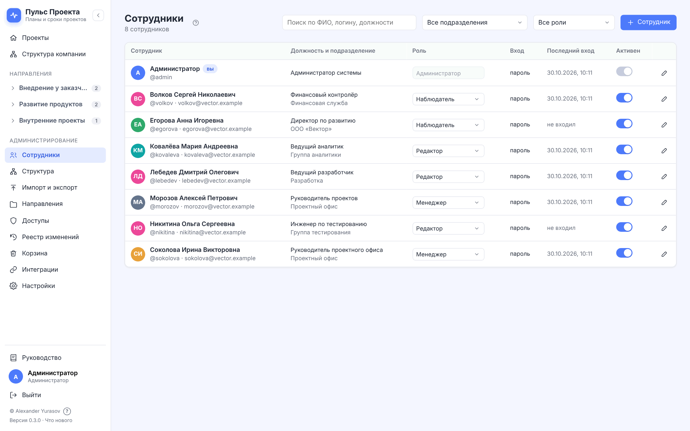
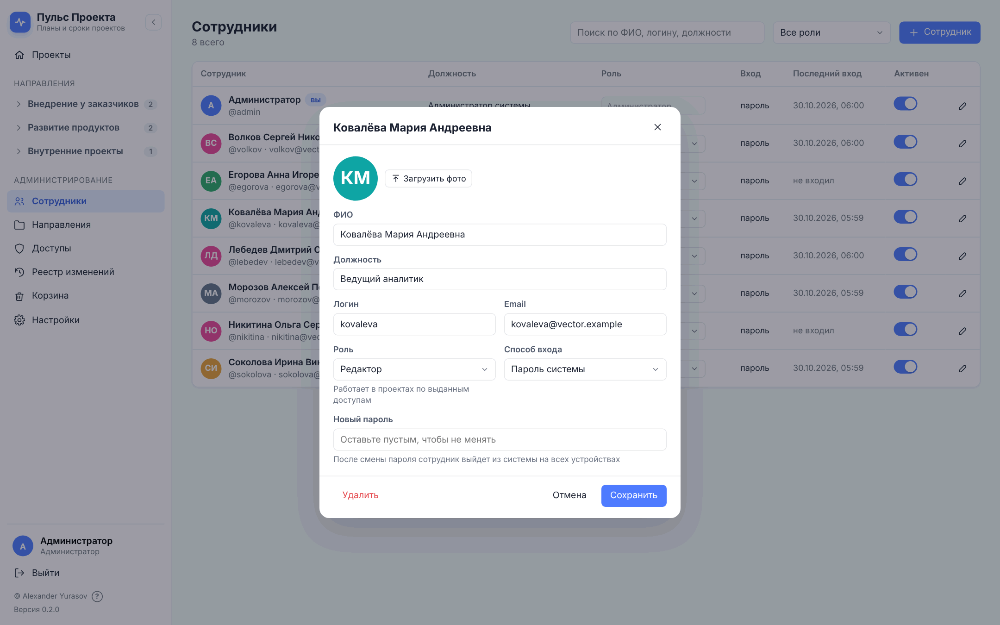
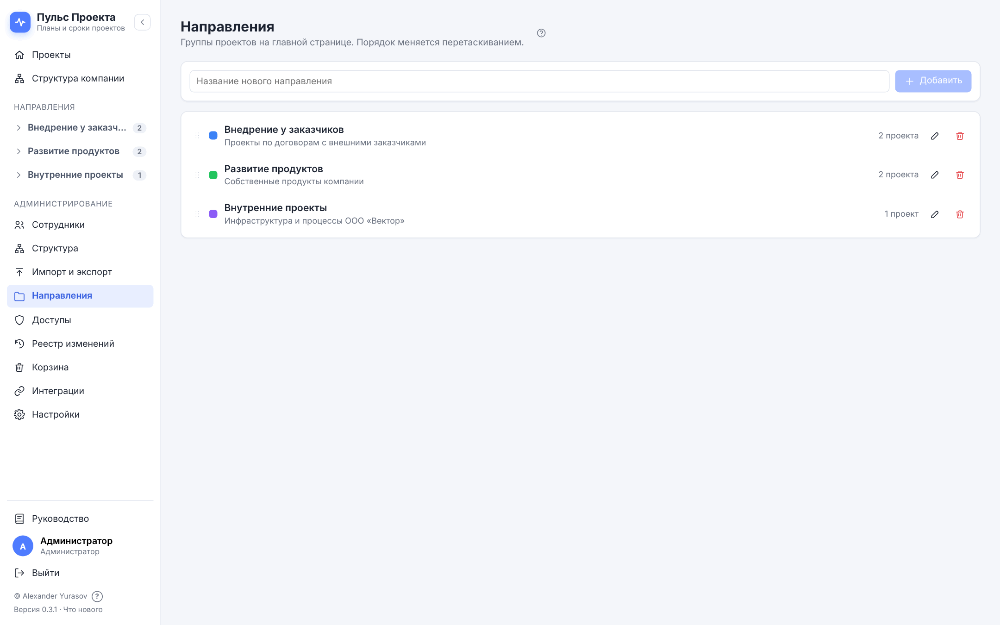
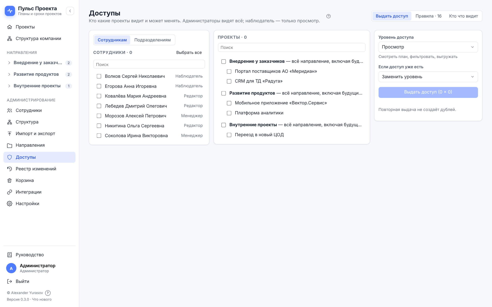
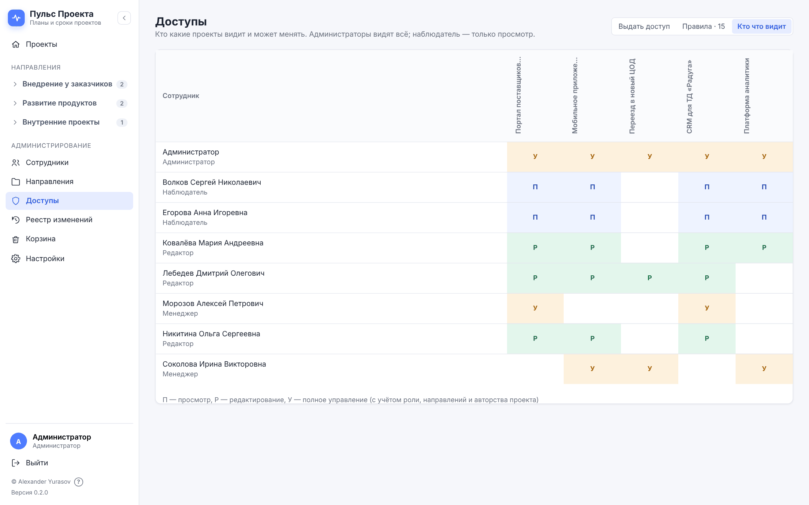
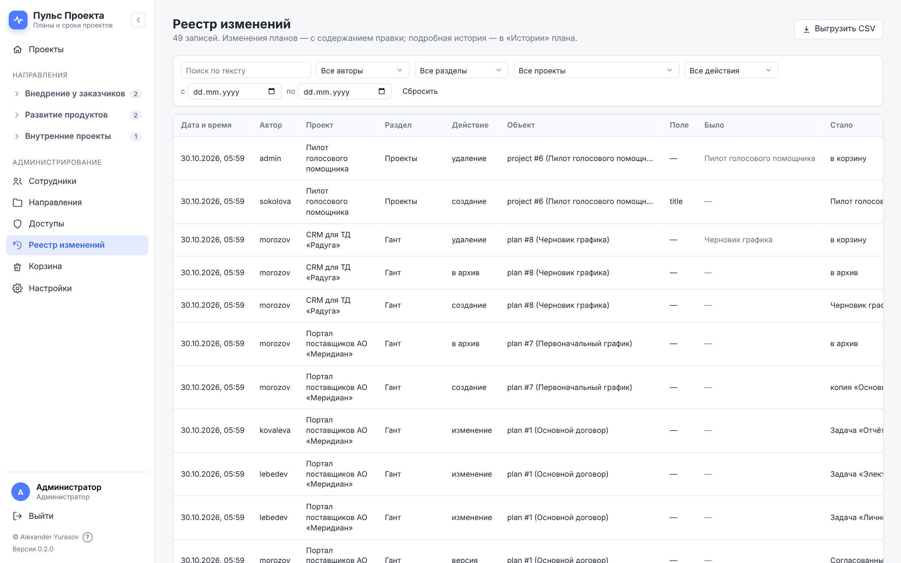
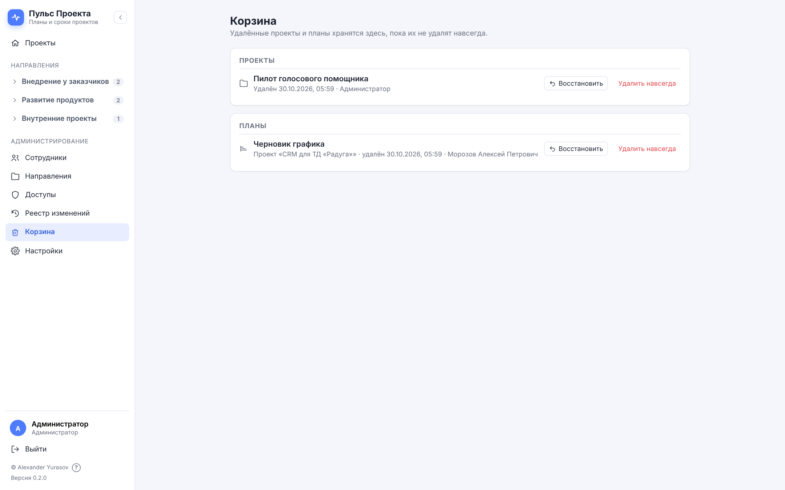
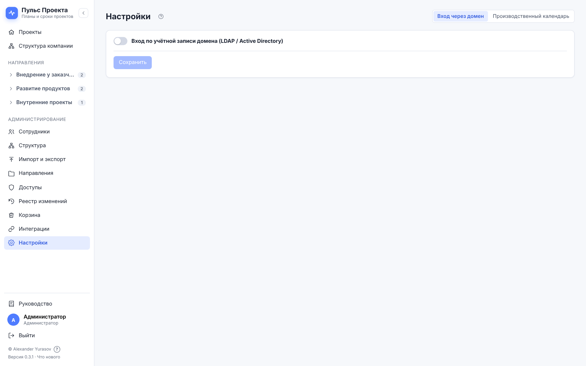
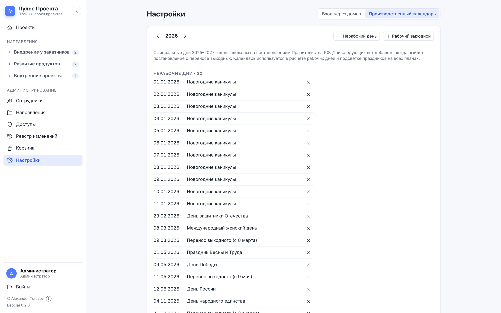

# О документе

Руководство описывает администрирование «Пульса Проекта» версии 0.2.1: роли и доступы, сотрудников,
направления, реестр изменений, корзину, вход через домен (LDAP / Active Directory) и производственный
календарь. Работа с проектами и планами — в «Руководстве пользователя», установка, обновление и резервное
копирование — в «Руководстве по развёртыванию».

Разделы администрирования видны в боковом меню только сотрудникам с ролью «Администратор». Снимки экрана
сделаны на демонстрационных данных вымышленной компании ООО «Вектор».

# Роли и права

## Роли

| Роль | Что может |
| --------------- | ---------------------------------------------------------------- |
| Администратор | Всё: все проекты с полным управлением, сотрудники, направления, доступы, реестр, корзина, настройки |
| Менеджер | Создаёт проекты и направления; полностью управляет **своими** проектами; к остальным — по правилам доступа |
| Редактор | Работает в проектах по выданным доступам |
| Наблюдатель | Только просмотр: даже если выдан уровень «Редактирование», наблюдатель лишь смотрит |

## Уровни доступа к проекту

| Уровень | Что можно |
| ---------------- | -------------------------------------------------------------- |
| Просмотр | Смотреть планы, историю и версии, статистику; фильтровать, выгружать |
| Редактирование | Плюс: править строки, пометки, исполнителей, настройки графика; создавать, копировать и архивировать планы; комментировать |
| Полное управление | Плюс: переименовывать проект и менять его направление; удалять планы в корзину и возвращать их оттуда |

Удалить проект (в корзину) и удалить что-либо навсегда может только администратор.

## Как считается доступ

1. Администратор видит всё с полным управлением.
2. Менеджер получает полное управление проектами, которые создал сам.
3. Правила доступа: «сотрудник → проект» или «сотрудник → направление» (все проекты направления, включая
   будущие). Если правил несколько, действует наибольший уровень.
4. Роль «Наблюдатель» ограничивает итог «просмотром».

Проверки выполняет сервер: недоступный проект не приходит в браузер вовсе.

## Защита от ошибок

- Нельзя отключить или удалить свою учётную запись и снять с себя роль администратора.
- Нельзя понизить или отключить последнего активного администратора.
- Повторная выдача доступа не создаёт дублей.
- Удалённые проекты и планы попадают в корзину; удалить навсегда — отдельное действие.

# Первичная настройка

## После перехода с 1.0.1

Сотрудники, их роли, пароли, фото, направления, проекты и доступы перенесены. Проверьте:

1. **Сотрудники** — администраторы на месте, отключённые отключены.
2. **Доступы → Кто что видит** — доступы как прежде. В 1.0.1 роль «Наблюдатель» не ограничивала правку; теперь
   наблюдатели только смотрят. Если наблюдатель должен править — смените ему роль на «Редактор».
3. **Настройки → Вход через домен** — режим и параметры перенесены; нажмите **Проверить подключение**.
4. **Настройки → Производственный календарь** — 2025–2027 годы заполнены официальными днями.

## Новая установка

Первый администратор (логин `admin`) создаётся из переменной `BOOTSTRAP_ADMIN_PASSWORD` при первом запуске
(руководство по развёртыванию). Войдите, смените пароль в профиле, затем:

1. **Направления** — создайте направления.
2. **Сотрудники** — заведите сотрудников или настройте вход через домен.
3. **Доступы** — выдайте доступы к направлениям или проектам.

# Сотрудники

## Список

«Администрирование → Сотрудники» — все учётные записи: ФИО, логин, email, должность, роль, способ входа
(пароль или домен), последний вход, переключатель «Активен».

Поиск — по ФИО, логину, должности; фильтр — по роли или «Отключённые»; заголовки столбцов сортируют список.
Роль меняется прямо в таблице; в уведомлении есть **Отменить**. Выдача и снятие роли «Администратор» —
с подтверждением.

## Добавление и изменение

**Сотрудник** — новая учётная запись: ФИО, должность, логин, email, роль, способ входа. Для входа по паролю
системы задайте пароль (не короче 8 символов). Для входа через домен пароль не нужен — сотрудник входит
доменной учётной записью.

Карандаш в строке — изменить. В окне — фото (загрузить или удалить), все поля и **Новый пароль**: после смены
пароля сотрудник выходит из системы на всех устройствах.

> **Совет.** Сотрудников, входящих через домен, заводить заранее не обязательно: учётная запись создаётся при
> первом входе с ролью по умолчанию из настроек домена. Доступы к проектам выдайте после первого входа.

## Отключение и удаление

- **Отключение** (переключатель «Активен») — сотрудник сразу выходит со всех устройств и не может войти.
  Данные, доступы и история сохраняются; включить можно в любой момент. Это обычный способ для увольнения.
- **Удаление** (в карточке) — необратимо: пропадают учётная запись и доступы. Комментарии и записи истории
  остаются с именем сотрудника.

# Направления

«Администрирование → Направления» — группы проектов: название, описание, цвет. Порядок направлений —
перетаскиванием; он же порядок на главной странице и в боковом меню.

При удалении направления его проекты переходят в «Без направления», доступы к направлению отзываются.

Менеджеры создают направления из окна нового проекта (**Направление → + Новое направление…**).

# Доступы

«Администрирование → Доступы» — три вкладки.

## Выдать доступ

Отметьте сотрудников слева и проекты или направления целиком в середине («всё направление, включая будущие
проекты»), выберите **Уровень доступа** и что делать, **если доступ уже есть**:

- **Заменить уровень** — установить выбранный уровень (в том числе понизить);
- **Только повысить** — поднять уровень там, где он ниже, остальное не трогать.

Кнопка **Выдать доступ (N × M)** показывает, сколько сотрудников и объектов выбрано.

## Правила

Вкладка **Правила** — все действующие правила: сотрудник, проект или направление, уровень. Уровень меняется в
строке; **Отозвать** — одно правило, флажки и **Отозвать выбранные** — несколько сразу.

## Кто что видит

Матрица «сотрудник × проект» с действующими уровнями — с учётом ролей, правил на направления и собственных
проектов менеджеров. Удобно для проверки после изменений.

# Реестр изменений

«Администрирование → Реестр изменений» — журнал всех изменений системы: сотрудники, доступы, проекты, планы,
правки графиков (сводкой), настройки. Записи 1.0.1 перенесены.

Автор показан по ФИО (логин — во всплывающей подсказке), объекты — названиями («Проект «…»», «Сотрудник …»),
поля и значения — по-русски; записи, перенесённые из прежней версии, показываются так же (сами записи не
меняются). Длинные значения переносятся; щелчок по строке показывает запись целиком.

Фильтры: раздел, действие, автор, проект, период; поиск по тексту. **Выгрузить CSV** — записи с текущими
фильтрами для Excel. Подробная история правок конкретного плана — в «Истории плана» на экране проекта.

# Корзина

«Администрирование → Корзина» — удалённые проекты и планы: кто и когда удалил. **Восстановить** возвращает
объект на место (проект — в своё направление, план — во вкладки или в архив проекта, откуда его удалили).
**Удалить навсегда** — необратимо и доступно только администратору.

Менеджер видит в боковом меню свою **Корзину** — удалённые планы проектов, которыми он полностью управляет, —
и может вернуть их. Сразу после удаления проект или план можно вернуть и кнопкой **Отменить** в уведомлении.

# Вход через домен

«Администрирование → Настройки → Вход через домен» — вход по учётной записи LDAP (Active Directory, FreeIPA,
OpenLDAP и др.).

| Поле | Значение |
| ------------- | ------------------------------------------------------------ |
| Режим | **Только пароли системы**; **Только учётная запись домена** (локальные администраторы сохраняют вход по паролю — ошибка в настройках не отрежет всех от системы); **Сначала домен, затем пароль системы** (выбирается сам при включении входа через домен) |
| Адрес сервера | `ldaps://dc.company.ru:636` (рекомендуется LDAPS) или `ldap://…:389` |
| Сервисная учётная запись (Bind DN) | Учётная запись для поиска сотрудников, например `cn=svc-puls,ou=Service,dc=company,dc=ru` |
| Пароль сервисной учётной записи | Хранится на сервере и в интерфейс не возвращается — поле показывает маску. Чтобы не менять пароль, не трогайте поле; очищенное поле сохраняет пустой пароль |
| Base DN | Где искать сотрудников, например `dc=company,dc=ru` |
| Фильтр поиска | `{{username}}` заменяется на введённый логин. Active Directory: `(sAMAccountName={{username}})`; OpenLDAP: `(uid={{username}})` |
| Атрибуты логина, ФИО, email | AD: `sAMAccountName`, `displayName`, `mail`; OpenLDAP: `uid`, `cn`, `mail` |
| Роль новых сотрудников домена | Роль учётной записи, создаваемой при первом входе (по умолчанию «Наблюдатель») |
| Таймаут, с | Ожидание ответа сервера каталога |

Изменения применяются кнопкой **Сохранить**; если уйти со страницы с несохранёнными изменениями, система
спросит, сохранить ли их.

**Проверить подключение** — подключение сервисной учётной записью без сохранения. **Сохранить** — применить.

При входе через домен ФИО и email сотрудника обновляются из каталога. Если сотрудник раньше входил по паролю
системы, его учётная запись переводится на вход через домен (пароль системы удаляется). Исключение —
локальные администраторы: они никогда не связываются с каталогом и всегда входят паролем системы (иначе
учётная запись каталога с тем же логином получила бы права администратора).

# Производственный календарь

«Администрирование → Настройки → Производственный календарь» — праздники, переносы и рабочие выходные по годам.
По нему считаются рабочие дни в длительности задач и выделяются праздники на графике.

- Стрелки — выбор года. Официальные дни 2025–2027 годов (по постановлениям Правительства РФ) заполнены при
  установке.
- **+ Нерабочий день** — праздник или перенесённый выходной; **+ Рабочий выходной** — рабочая суббота.
  Свои дни помечены «своё»; × — убрать.
- На год без дней считаются выходными только субботы и воскресенья.

> **Совет.** Постановление о переносе выходных на следующий год обычно выходит осенью — добавьте дни, как
> только оно опубликовано.

# Работа сервиса

- **Версия** — внизу бокового меню и на странице «О программе».
- **Резервные копии** — ежедневно, хранение 30 дней; копия перед каждым обновлением. Восстановление —
  руководство по развёртыванию.
- **Забытый пароль администратора** — инженер сопровождения сбрасывает его командой
  `docker compose exec backend flask --app wsgi reset-password <логин>`.
- **Журналы** — `docker compose logs backend`.

# Сценарии администратора

## Сценарий А1. Новый сотрудник проектного офиса

1. **Сотрудники → Сотрудник**: ФИО, должность, логин, email, роль «Редактор», способ входа (домен или пароль).
2. **Доступы → Выдать доступ**: сотрудник → направление «Проектный офис» → «Редактирование».
3. Сотрудник входит и видит все проекты направления, включая будущие.

## Сценарий А2. Увольнение

1. **Сотрудники** → переключатель «Активен» у сотрудника → **Отключить**: сотрудник сразу выходит со всех
   устройств.
2. В планах, где он исполнитель, назначьте другого исполнителя (карточка задачи или «Исполнители плана»).
3. Учётную запись не удаляйте — его комментарии и история останутся понятными.

## Сценарий А3. Наблюдатель должен править план

Роль «Наблюдатель» ограничивает любой доступ просмотром. Смените роль на «Редактор» (в таблице сотрудников) и
проверьте уровень доступа к проекту — «Редактирование».

## Сценарий А4. Руководителю нужен обзор всех проектов направления

**Доступы → Выдать доступ**: руководитель → направление целиком → «Просмотр» (или «Редактирование»). Роль
«Менеджер» даст ему право создавать проекты.

## Сценарий А5. Удалённый план нужно вернуть

**Корзина → Планы** → **Восстановить**: план возвращается туда, откуда его удалили, — во вкладки или в архив
проекта (тогда откройте проект → **Архив** → **Вернуть во вкладки**).

## Сценарий А6. Сотрудник забыл пароль

Для входа по паролю системы: **Сотрудники** → карточка → **Новый пароль** → сообщите временный пароль, сотрудник
сменит его в профиле. Для входа через домен пароль меняется средствами домена.

## Сценарий А7. Переход на вход через домен

1. **Настройки → Вход через домен**: адрес, сервисная учётная запись, Base DN, фильтр, атрибуты.
2. **Проверить подключение**.
3. Режим **Сначала домен, затем пароль системы** — переходный: работают оба способа.
4. Когда все сотрудники вошли через домен, при необходимости переключите режим на **Только учётная запись
   домена** — локальные администраторы сохранят вход по паролю.

## Сценарий А8. Кто удалил строку в плане?

Откройте проект → **История плана → Журнал изменений** и отфильтруйте по сотруднику или найдите запись
«… удалена». Для общей картины по системе — **Реестр изменений** с фильтром по проекту.

# Рекомендации по безопасности

- Держите не меньше двух активных администраторов; работайте под личными учётными записями.
- Выдавайте доступ к направлениям, а не к каждому проекту, — меньше правил, проще проверка.
- Для увольнения отключайте учётную запись; удаляйте только ошибочно созданные.
- Включите HTTPS (руководство по развёртыванию) — пароли и сессии не должны идти по сети открытым текстом.
- Регулярно смотрите **Доступы → Кто что видит** и **Реестр изменений**.

# Частые вопросы

**Сотрудник не видит проект.** Проверьте **Кто что видит**: нет правила ни на проект, ни на его направление, или
сотрудник отключён.

**Сотрудник видит проект, но не может править.** Роль «Наблюдатель» или уровень «Просмотр»; либо план в архиве.

**Сотрудник домена не может войти.** **Проверить подключение** в настройках; проверьте фильтр поиска и
атрибут логина; отключённая учётная запись не входит даже при верном доменном пароле.

**Где настройки графиков?** У каждого плана свои — «Настройки графика» на экране проекта (руководство
пользователя).
