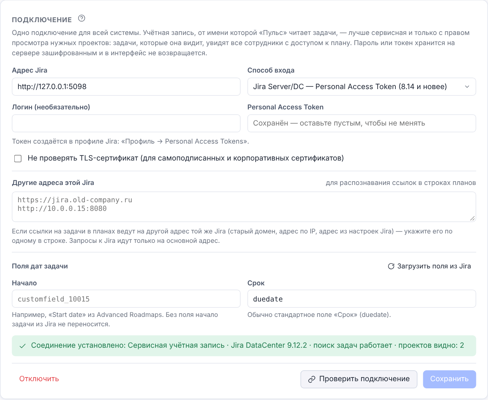
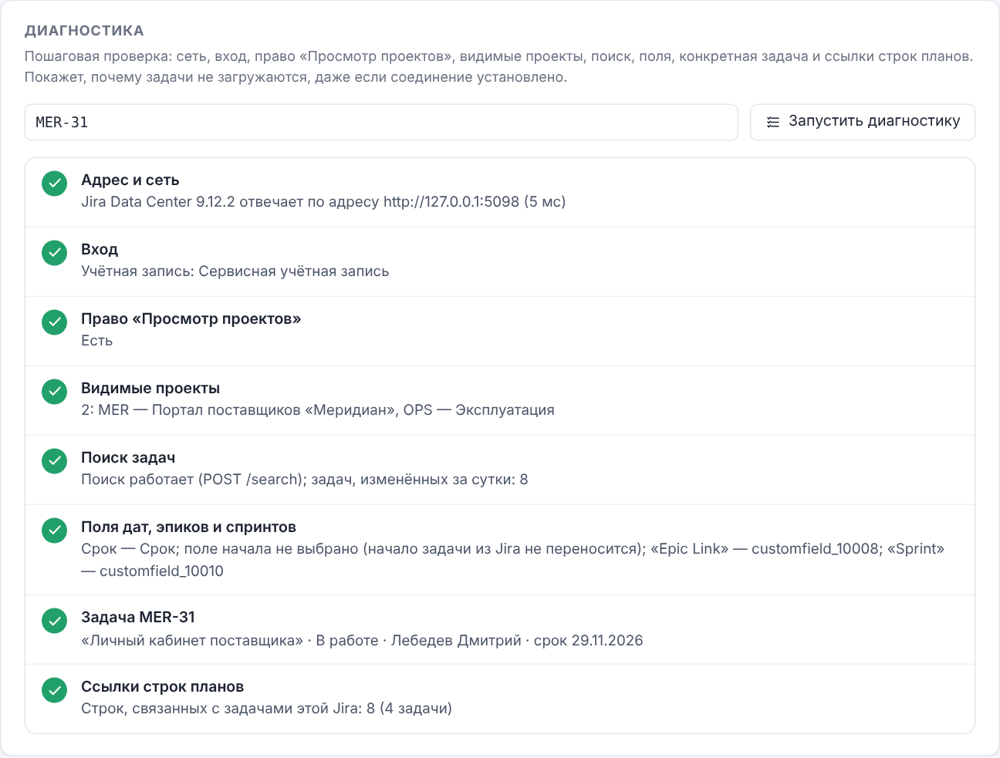
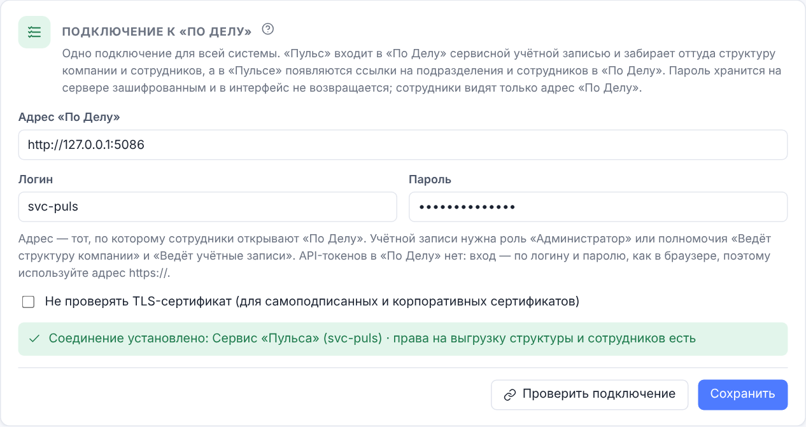

# О документе

Руководство описывает администрирование «Пульса Проекта» версии 0.5.0: роли и доступы, сотрудников,
направления, реестр изменений, корзину, вход через домен (LDAP / Active Directory) и производственный
календарь. Работа с проектами и планами — в «Руководстве пользователя», установка, обновление и резервное
копирование — в «Руководстве по развёртыванию».

Разделы администрирования видны в боковом меню только сотрудникам с ролью «Администратор». Снимки экрана
сделаны на демонстрационных данных вымышленной компании ООО «Вектор».

# Роли и права

## Роли

| Роль | Что может |
| --------------- | ---------------------------------------------------------------- |
| Администратор | Всё: все проекты с полным управлением, сотрудники, направления, доступы, реестр, корзина, настройки |
| Менеджер | Создаёт проекты и направления; полностью управляет **своими** проектами; к остальным — по правилам доступа |
| Редактор | Работает в проектах по выданным доступам |
| Наблюдатель | Только просмотр: даже если выдан уровень «Редактирование», наблюдатель лишь смотрит |

## Уровни доступа к проекту

| Уровень | Что можно |
| ---------------- | -------------------------------------------------------------- |
| Просмотр | Смотреть планы, историю и версии, статистику; фильтровать, выгружать |
| Редактирование | Плюс: править строки, пометки, исполнителей, настройки графика; создавать, копировать и архивировать планы; комментировать |
| Полное управление | Плюс: переименовывать проект и менять его направление; удалять планы в корзину и возвращать их оттуда |

Удалить проект (в корзину) и удалить что-либо навсегда может только администратор.

## Как считается доступ

1. Администратор видит всё с полным управлением.
2. Менеджер получает полное управление проектами, которые создал сам.
3. Правила доступа: «сотрудник → проект» или «сотрудник → направление» (все проекты направления, включая
   будущие).
4. Правила подразделений: «подразделение → проект» или «подразделение → направление» — действуют на сотрудников
   подразделения и всех вложенных, в том числе пришедших позже (см. «Структура компании»).

   Если правил несколько, действует наибольший уровень.
5. Роль «Наблюдатель» ограничивает итог «просмотром».

Проверки выполняет сервер: недоступный проект не приходит в браузер вовсе.

## Защита от ошибок

- Нельзя отключить или удалить свою учётную запись и снять с себя роль администратора.
- Нельзя понизить или отключить последнего активного администратора.
- Повторная выдача доступа не создаёт дублей.
- Удалённые проекты и планы попадают в корзину; удалить навсегда — отдельное действие.

# Первичная настройка

## После перехода с 1.0.1

Сотрудники, их роли, пароли, фото, направления, проекты и доступы перенесены. Проверьте:

1. **Сотрудники** — администраторы на месте, отключённые отключены.
2. **Доступы → Кто что видит** — доступы как прежде. В 1.0.1 роль «Наблюдатель» не ограничивала правку; теперь
   наблюдатели только смотрят. Если наблюдатель должен править — смените ему роль на «Редактор».
3. **Интеграции → Вход через домен** — режим и параметры перенесены; нажмите **Проверить подключение**.
4. **Администрирование → Календарь** (производственный календарь) — 2025–2027 годы заполнены официальными днями.

## Новая установка

Первый администратор (логин `admin`) создаётся из переменной `BOOTSTRAP_ADMIN_PASSWORD` при первом запуске
(руководство по развёртыванию). Войдите, смените пароль в профиле, затем:

1. **Направления** — создайте направления.
2. **Сотрудники** — заведите сотрудников или настройте вход через домен.
3. **Доступы** — выдайте доступы к направлениям или проектам.

# Сотрудники

## Список

«Администрирование → Сотрудники» — все учётные записи: ФИО, логин, email, должность, роль, способ входа
(пароль или домен), последний вход, переключатель «Активен».


Поиск — по ФИО, логину, должности; фильтр — по роли или «Отключённые»; заголовки столбцов сортируют список.
Роль меняется прямо в таблице; в уведомлении есть **Отменить**. Выдача и снятие роли «Администратор» —
с подтверждением.

## Добавление и изменение

**Сотрудник** — новая учётная запись: ФИО, должность, логин, email, роль, способ входа. Для входа по паролю
системы задайте пароль (не короче 8 символов). Для входа через домен пароль не нужен — сотрудник входит
доменной учётной записью.

Карандаш в строке — изменить. В окне — фото (загрузить или удалить), все поля и **Новый пароль**: после смены
пароля сотрудник выходит из системы на всех устройствах.


> **Совет.** Сотрудников, входящих через домен, заводить заранее не обязательно: учётная запись создаётся при
> первом входе с ролью по умолчанию из настроек домена. Доступы к проектам выдайте после первого входа.

## Отключение и удаление

- **Отключение** (переключатель «Активен») — сотрудник сразу выходит со всех устройств и не может войти.
  Данные, доступы и история сохраняются; включить можно в любой момент. Это обычный способ для увольнения.
- **Удаление** (в карточке) — необратимо: пропадают учётная запись и доступы. Комментарии и записи истории
  остаются с именем сотрудника.

# Структура компании

Структура общая с «По Делу»: те же подразделения, типы, руководители и правила подчинения, те же файлы обмена.
Сотрудники видят её в разделе **Структура компании** главного меню; изменяет администратор в
«Администрирование → Структура».


## Подразделения

- **Добавить** — название, куда входит (верхний уровень или подразделение) и тип: компания, дирекция,
  направление, служба, отдел, сектор, группа, позиция. Названия не повторяются среди соседних подразделений.
- Кнопки в строке: **+** — вложенное подразделение, **Руководители**, **Изменить** (название, куда входит, тип,
  порядок среди соседних), **Удалить** (только без вложенных; сотрудники остаются без подразделения).
- Число сотрудников ведёт в список сотрудников подразделения; «в ветке» — вместе с вложенными.
- **Типы и уровни** — подписи и цвета типов, свои типы, наибольшая глубина структуры (по умолчанию 15). Тип,
  который уже используется, убрать нельзя.

## Руководители и подчинение

У подразделения может быть несколько руководителей; **основной** — непосредственный руководитель сотрудников
подразделения. Руководитель сотрудника определяется так:

1. «Первое лицо» — никому не подчиняется;
2. явно назначенный руководитель (в карточке сотрудника);
3. иначе — основной руководитель его подразделения; если это он сам или руководителя нет — руководитель
   вышестоящего подразделения и так далее.

Циклы подчинения система не допускает. Подразделение и руководитель сотрудника задаются в
«Администрирование → Сотрудники» в карточке сотрудника; там же фильтр по подразделению и «Без подразделения».

## Импорт и экспорт

«Администрирование → Импорт и экспорт» — загрузка и выгрузка структуры и сотрудников в форматах «По Делу»: файл,
выгруженный в одном инструменте, загружается в другом. Каждая загрузка сначала **проверяется**: система
показывает, что будет создано и изменено, и ошибки; **Применить** записывает всё одной операцией.


| Вкладка | Что переносит |
| -------------- | ---------------------------------------------------------- |
| Структура (JSON) | Подразделения, типы, руководители — файл `podelu.org-structure` |
| Сотрудники (CSV, JSON, ZIP) | Сотрудники с подразделением, руководителем, ролью, фото — файл `podelu.employees` |
| Быстрый импорт CSV | Люди и подразделения одной таблицей: email, ФИО, путь подразделения, должность, руководитель, «руководит» |
| Active Directory | Структура и сотрудники из каталога по подключению «Вход через домен» |
| Из «По Делу» | Структура и сотрудники прямо из «По Делу» по подключению в «Интеграциях» |

Поля «По Делу», которых в «Пульсе» нет (функциональные руководители, полномочия, часовой пояс, видимость), при
загрузке пропускаются с пояснением, при выгрузке остаются пустыми. Пустое значение в файле ничего не стирает.

**Структура (JSON).** **Выгрузить** — файл `puls-structure-<дата>.json`. При загрузке подразделения сопоставляются
по пути от корня (без учёта регистра и лишних пробелов): новые создаются, у существующих обновляются тип и порядок.
Подразделения, которых нет в файле, остаются и перечисляются отдельно. Руководители сопоставляются по email (или
логину) и только добавляются; если сотрудника ещё нет — назначение «ожидает» загрузки сотрудников. Настройки
структуры из файла (типы и глубина) применяются, если отмечено **Применить настройки**.

**Сотрудники.** Выгрузка — CSV (для Excel), JSON или ZIP с фото; можно включить отключённых сотрудников и
сотрудников без email (для «По Делу» их лучше не включать: там email обязателен). Загрузка принимает те же форматы
и файлы «По Делу»:

- сотрудник сопоставляется по email; если email в системе пуст — по логину; если логин занят сотрудником с другим
  email, система спросит: **тот же человек** или **новый**;
- если и в системе, и в файле значения есть и они различаются — это **коллизия**: на карточке сотрудника выберите
  **Система**, **Файл** (для «Руководит» — ещё **Объединить**) или сразу для всех: **Во всех коллизиях: оставить
  значения системы / взять из файла**;
- новые сотрудники создаются без пароля с ролью «Наблюдатель» (как их включить — **Новые сотрудники**:
  неактивными, активными или как в файле); пароль задаётся в «Сотрудниках» или вход через домен;
- роли «По Делу» понимаются: «Руководитель» — Менеджер, «Сотрудник» — роль не меняется (новому — Наблюдатель);
  права администратора файлом не выдаются — новый сотрудник с ролью «Администратор» создаётся наблюдателем;
- свою роль и свою учётную запись загрузкой изменить или отключить нельзя.

**Быстрый импорт CSV** — одна таблица «люди + подразделения», как в «По Делу»: столбцы email (или логин), ФИО,
путь подразделения через «/», должность, email руководителя, «руководит» (да/нет); разделитель «;» или «,»,
заголовки по-русски или по-английски. **Вставить пример** показывает формат. Отметьте **Создавать новых
сотрудников**, если в файле есть люди, которых ещё нет в системе.

**Active Directory** — структура и сотрудники из каталога по подключению «Вход через домен»: путь подразделения
берётся из атрибутов (по умолчанию `company, division, department`) или из OU, руководители — по атрибуту
`manager`, отключённые в каталоге — отключаются. **Отключать отсутствующих в каталоге** отключает сотрудников,
пришедших из каталога и пропавших из него. Синхронизацию по расписанию настраивают на сервере командой
`scripts/org_transfer.py sync-ad --apply` (см. руководство по развёртыванию).

# Направления

«Администрирование → Направления» — группы проектов: название, описание, цвет. Порядок направлений —
перетаскиванием; он же порядок на главной странице и в боковом меню.


При удалении направления его проекты переходят в «Без направления», доступы к направлению отзываются.

Менеджеры создают направления из окна нового проекта (**Направление → + Новое направление…**).

# Доступы

«Администрирование → Доступы» — три вкладки.

## Выдать доступ

Отметьте сотрудников слева и проекты или направления целиком в середине («всё направление, включая будущие
проекты»), выберите **Уровень доступа** и что делать, **если доступ уже есть**. Переключатель
**Сотрудникам / Подразделениям** над списком слева выдаёт доступ подразделениям: его получают все сотрудники
подразделения и вложенных, включая будущих; перешедший в другое подразделение сотрудник теряет доступ прежнего.

- **Заменить уровень** — установить выбранный уровень (в том числе понизить);
- **Только повысить** — поднять уровень там, где он ниже, остальное не трогать.

Кнопка **Выдать доступ (N × M)** показывает, сколько сотрудников и объектов выбрано.


## Правила

Вкладка **Правила** — все действующие правила: сначала подразделениям (с путём и числом сотрудников в ветке),
затем сотрудникам — проект или направление, уровень. Уровень меняется в строке; **Отозвать** — одно правило,
флажки и **Отозвать выбранные** — несколько сразу.


## Кто что видит

Матрица «сотрудник × проект» с действующими уровнями — с учётом ролей, правил на направления и подразделения
и собственных проектов менеджеров. Удобно для проверки после изменений.


# Реестр изменений

«Администрирование → Реестр изменений» — журнал всех изменений системы: сотрудники, доступы, проекты, планы,
правки графиков (сводкой), настройки. Записи 1.0.1 перенесены.


Автор показан по ФИО (логин — во всплывающей подсказке), объекты — названиями («Проект «…»», «Сотрудник …»),
поля и значения — по-русски; записи, перенесённые из прежней версии, показываются так же (сами записи не
меняются). Длинные значения переносятся; щелчок по строке показывает запись целиком.

Фильтры: раздел, действие, автор, проект, период; поиск по тексту. **Выгрузить CSV** — записи с текущими
фильтрами для Excel. Подробная история правок конкретного плана — в «Истории плана» на экране проекта.

# Корзина

«Администрирование → Корзина» — удалённые проекты и планы: кто и когда удалил. **Восстановить** возвращает
объект на место (проект — в своё направление, план — во вкладки или в архив проекта, откуда его удалили).
**Удалить навсегда** — необратимо и доступно только администратору.

Менеджер видит в боковом меню свою **Корзину** — удалённые планы проектов, которыми он полностью управляет, —
и может вернуть их. Сразу после удаления проект или план можно вернуть и кнопкой **Отменить** в уведомлении.


# Интеграции

**Интеграции** — отдельный блок бокового меню администратора: **Jira**, **«По Делу»** и **Вход через домен** (LDAP
/ Active Directory). Заголовок блока открывает обзор: у каждой интеграции — состояние (подключена, настроена
частично, не подключена), адрес и главное о подключении, кнопка **Настроить**. У каждой интеграции одно подключение
на систему; пароли и ключи хранятся зашифрованными (ключ выводится из `SECRET_KEY`) и в интерфейс не возвращаются.


## Jira

Подключение к Jira такое же, как в burndown_tool: сотрудники видят статусы и сроки задач Jira, привязанных к
строкам планов, переносят их в план вручную или автоматически (настройка плана), добавляют строки из проектов
Jira (с фильтрами, группами по эпикам и спринтам, связями «блокирует») и вехи по релизам.



1. **Адрес Jira** — например, `https://jira.company.ru` (для Jira Cloud — `https://company.atlassian.net`).
2. **Способ входа**: Jira Server/DC — логин и пароль; Jira Server/DC — Personal Access Token (8.14 и новее);
   Jira Cloud — email и API-токен.
3. Логин (или email) и пароль (или токен). Пароль хранится зашифрованным и в интерфейс не возвращается; чтобы не
   менять его, оставьте поле пустым. После смены адреса пароль нужно ввести заново — сохранённый пароль уходит
   только на адрес, для которого был введён.
4. **Не проверять TLS-сертификат** — только для самоподписанных и корпоративных сертификатов.
5. **Другие адреса этой Jira** — если ссылки на задачи в планах ведут на другой адрес той же Jira (старый домен,
   адрес по IP, адрес из настроек самой Jira), укажите его по одному в строке: такие строки тоже свяжутся с
   задачами. Запросы к Jira идут только на основной адрес.
6. **Поля дат задачи**: **Загрузить поля из Jira** и выберите поле начала (например, Start date) и срока (обычно
   «Срок», duedate).
7. **Проверить подключение** → «Соединение установлено: <учётная запись> · Jira DataCenter 9.12 · поиск задач
   работает · проектов видно: N». Проверка входит в Jira, выполняет поиск тем же запросом, каким читаются задачи
   планов, и считает видимые проекты. Если учётная запись не видит ни одного проекта или Jira называет свой адрес
   иначе, чем указано в подключении, проверка предупредит и предложит **Добавить в другие адреса**.
8. **Сохранить** — без него подключение не действует. Пока изменения не сохранены, кнопка подсвечена, а при уходе со
   страницы система спросит, сохранить ли их.

Учётная запись подключения определяет, какие задачи видны всем сотрудникам с доступом к плану. Используйте
сервисную учётную запись с правом только просмотра нужных проектов Jira. «Пульс» в Jira ничего не записывает.

**Отключить** удаляет подключение и пароль; ссылки строк на задачи сохраняются.

### Диагностика

Если Jira «подключена, но задачи не загружаются», откройте **Диагностику** на странице Jira, при желании введите
ключ задачи и нажмите **Запустить диагностику**. Шаги и что значит ошибка:



| Шаг | Что проверяется | Что делать при ошибке |
| ----------- | ---------------------------- | --------------------------------- |
| Адрес и сеть | Jira отвечает, её вид и версия, время ответа | Проверить адрес, сеть, прокси (`HTTPS_PROXY`), `JIRA_ALLOWED_HOSTS` |
| Способ входа | Совпадает ли вид Jira со способом входа | Для Cloud — email и API-токен, для Server/DC — PAT или логин и пароль |
| Адрес ссылок на задачи | Адрес, который Jira считает своим | Добавить его в «Другие адреса этой Jira» |
| Вход | Учётная запись принимается | Проверить логин и пароль или токен; при CAPTCHA — войти в Jira браузером |
| Право «Просмотр проектов» | Есть ли право Browse Projects | Добавить учётную запись в роль или группу проекта |
| Видимые проекты | Сколько и каких проектов видно | Выдать доступ к нужным проектам |
| Поиск задач | Поиск работает (POST или запасной GET) | Причина — в тексте ошибки Jira |
| Поля дат, эпиков и спринтов | Поля начала и срока существуют; найдены «Epic Link» и «Sprint» | Выбрать поля заново |
| Задача ABC-123 | Задача читается: тема, статус, исполнитель, срок | «Не найдена» — нет задачи или права её видеть |
| Ссылки строк планов | Сколько строк связано и сколько ссылается на другие адреса | Добавить адрес в «Другие адреса этой Jira» |

Если перед Jira стоит прокси, запрещающий POST-запросы к поиску, «Пульс» сам переходит на GET — это видно в шаге
«Поиск задач».

## «По Делу»

Страница **Интеграции → «По Делу»** состоит из двух независимых частей: **Ссылки из задач «По Делу»** (задачи
сотрудников ссылаются на проекты и строки планов «Пульса») и **Структура и сотрудники из «По Делу»** (загрузка
структуры компании и сотрудников).



### Ссылки из задач «По Делу»

Сотрудник в карточке задачи «По Делу» (раздел **Пульс проекта**) выбирает проект «Пульса» и, по желанию, конкретную
строку плана. В «Пульсе» на проекте появляется кнопка **По Делу** со списком этих задач, а в карточке строки —
раздел **Задачи в «По Делу»**. Связь настраивается обменом ключами — как у вебхуков, каждая система выпускает свой
ключ, а администратор вводит его в другую систему:

1. **Ключ «Пульса» для «По Делу»** — **Выпустить ключ**. Ключ (`puls_…`) показывается один раз: **Скопировать** и
   вставьте его в «По Делу»: Настройки → Интеграции → «Пульс проекта» (там же — адрес «Пульса»). С этим ключом «По
   Делу» ищет проекты и строки планов — только те, что доступны сотруднику в «Пульсе»: сотрудник находится по
   идентификатору «По Делу», затем по логину и email; если его нет в «Пульсе», проектов он не увидит. «Пульс»
   хранит только отпечаток ключа и показывает, когда «По Делу» обращалась к нему последний раз. **Выпустить
   новый** сразу отменяет прежний ключ, **Отозвать** — отключает доступ «По Делу».
2. **Адрес и ключ «По Делу»** — в «По Делу» выпустите **Ключ для «Пульса»** (`podelu_…`) и введите его здесь вместе
   с адресом «По Делу» → **Сохранить и проверить**. Проверка обращается к «По Делу» с ключом и сообщает её версию;
   предупреждает, если в «По Делу» ссылки на проекты ещё выключены или ключ «Пульса» не выпущен. Ключ хранится
   зашифрованным; после смены адреса его нужно ввести заново, после смены адреса или ключа — проверить снова.
3. **Показывать задачи «По Делу» в проектах** — включается только после успешной проверки.

**Отключить ссылки из задач** удаляет адрес, оба ключа и выключает показ; ссылки, сохранённые в задачах «По Делу»,
остаются.

Что видно: название, статус, исполнитель и срок задачи — всем, у кого есть доступ к проекту в «Пульсе». Сотрудникам
«По Делу» показывает это предупреждение при привязке. Адреса «По Делу» ограничивает `PODELU_ALLOWED_HOSTS`.

### Структура и сотрудники из «По Делу»

«Пульс» берёт структуру компании и сотрудников прямо из «По Делу» и показывает на карточках подразделений и
сотрудников ссылку **Открыть в «По Делу»**. Структура и сотрудники загружаются тем же порядком, что и файлы
«По Делу» в «Импорте и экспорте»: сначала план изменений, затем применение одной операцией.

1. В «По Делу» заведите сервисную учётную запись с полномочиями **Ведёт структуру компании** и **Ведёт учётные
   записи** (или роль «Администратор»). Выгрузки структуры и сотрудников «По Делу» отдаёт после входа по логину и
   паролю.
2. «Интеграции → «По Делу» → Структура и сотрудники из «По Делу»»: адрес, по которому сотрудники открывают «По Делу»
   (`https://…`), логин и пароль; **Не проверять TLS-сертификат** — только для самоподписанных сертификатов.
3. **Проверить подключение** → «Соединение установлено… права на выгрузку структуры и сотрудников есть» →
   **Сохранить**. Если вход удался, а прав не хватает, проверка скажет, каких. После смены адреса или логина
   пароль нужно ввести заново.
4. **Загрузить структуру и сотрудников** (или «Импорт и экспорт → Из «По Делу»»): выберите, переносить ли
   настройки структуры и фото и создавать ли новых сотрудников (по умолчанию — отключёнными) → **Получить план
   из «По Делу»**.
5. Проверьте план: новые и изменённые подразделения (переименованные и перенесённые в «По Делу» сопоставляются по
   её идентификатору), новые сотрудники, коллизии — в коллизиях выберите **Система**, **По Делу** или своё
   значение.
6. **Применить** ещё раз получает данные из «По Делу» и записывает всё одной транзакцией. Если в «По Делу» что-то
   изменилось после проверки, появится новый план.

Подразделения, загруженные из «По Делу», ведутся в «По Делу»: переименование или перенос там при следующей загрузке
меняет подразделение «Пульса» на месте (руководители, сотрудники и доступы сохраняются), а правка такого
подразделения в «Пульсе» при следующей загрузке вернётся к варианту «По Делу» — план это покажет.

Ничего не удаляется: подразделение, которого больше нет в «По Делу», остаётся в «Пульсе» (план перечислит такие). Права администратора из
«По Делу» не выдаются, пароли не переносятся. Сотрудники сопоставляются по идентификатору «По Делу», затем по
email и логину — ответ «это один и тот же человек» запоминается.

По расписанию (cron на сервере):

```bash
docker compose exec -T backend python scripts/org_transfer.py sync-podelu --actor admin --create-missing --apply
```

С `--prefer-podelu` в коллизиях берутся значения «По Делу» (кроме роли, логина и email); код выхода 1 — в плане
ошибки, 2 — «По Делу» недоступна. Адреса подключения ограничивает переменная `PODELU_ALLOWED_HOSTS`.

## Вход через домен

**Интеграции → Вход через домен** — вход по учётной записи LDAP (Active Directory, FreeIPA, OpenLDAP и др.). Тот
же каталог и сервисная учётная запись используются для синхронизации структуры с Active Directory («Импорт и
экспорт»).


| Поле | Значение |
| ------------- | ------------------------------------------------------------- |
| Режим | **Только пароли системы**; **Только учётная запись домена** (локальные администраторы сохраняют вход по паролю — ошибка в настройках не отрежет всех от системы); **Сначала домен, затем пароль системы** (выбирается сам при включении входа через домен) |
| Адрес сервера | `ldaps://dc.company.ru:636` (рекомендуется LDAPS) или `ldap://…:389` |
| Сервисная учётная запись (Bind DN) | Учётная запись для поиска сотрудников, например `cn=svc-puls,ou=Service,dc=company,dc=ru` |
| Пароль сервисной учётной записи | Хранится на сервере и в интерфейс не возвращается — поле показывает маску. Чтобы не менять пароль, не трогайте поле; очищенное поле сохраняет пустой пароль |
| Base DN | Где искать сотрудников, например `dc=company,dc=ru` |
| Фильтр поиска | `{{username}}` заменяется на введённый логин. Active Directory: `(sAMAccountName={{username}})`; OpenLDAP: `(uid={{username}})` |
| Атрибуты логина, ФИО, email | AD: `sAMAccountName`, `displayName`, `mail`; OpenLDAP: `uid`, `cn`, `mail` |
| Роль новых сотрудников домена | Роль учётной записи, создаваемой при первом входе (по умолчанию «Наблюдатель») |
| Таймаут, с | Ожидание ответа сервера каталога |

Изменения применяются кнопкой **Сохранить**; если уйти со страницы с несохранёнными изменениями, система
спросит, сохранить ли их.

**Проверить подключение** — подключение сервисной учётной записью без сохранения. **Сохранить** — применить.

При входе через домен ФИО и email сотрудника обновляются из каталога. Если сотрудник раньше входил по паролю
системы, его учётная запись переводится на вход через домен (пароль системы удаляется). Исключение —
локальные администраторы: они никогда не связываются с каталогом и всегда входят паролем системы (иначе
учётная запись каталога с тем же логином получила бы права администратора).

# Производственный календарь

«Администрирование → Календарь» — праздники, переносы и рабочие выходные по годам.
По нему считаются рабочие дни в длительности задач и выделяются праздники на графике.


- Стрелки — выбор года. Официальные дни 2025–2027 годов (по постановлениям Правительства РФ) заполнены при
  установке.
- **+ Нерабочий день** — праздник или перенесённый выходной; **+ Рабочий выходной** — рабочая суббота.
  Свои дни помечены «своё»; × — убрать.
- На год без дней считаются выходными только субботы и воскресенья.

> **Совет.** Постановление о переносе выходных на следующий год обычно выходит осенью — добавьте дни, как
> только оно опубликовано.

# Работа сервиса

- **Версия** — внизу бокового меню и на странице «О программе».
- **Руководства** — пункт «Руководство» в боковом меню: руководство пользователя, а администратору и это
  руководство (переключатель вверху страницы); значок «?» в разделах администрирования открывает нужный раздел.
- **Резервные копии** — ежедневно, хранение 30 дней; копия перед каждым обновлением. Восстановление —
  руководство по развёртыванию.
- **Забытый пароль администратора** — инженер сопровождения сбрасывает его командой
  `docker compose exec backend flask --app wsgi reset-password <логин>`.
- **Журналы** — `docker compose logs backend`.

# Сценарии администратора

## Сценарий А1. Новый сотрудник проектного офиса

1. **Сотрудники → Сотрудник**: ФИО, должность, логин, email, роль «Редактор», способ входа (домен или пароль).
2. **Доступы → Выдать доступ**: сотрудник → направление «Проектный офис» → «Редактирование».
3. Сотрудник входит и видит все проекты направления, включая будущие.

## Сценарий А2. Увольнение

1. **Сотрудники** → переключатель «Активен» у сотрудника → **Отключить**: сотрудник сразу выходит со всех
   устройств.
2. В планах, где он исполнитель, назначьте другого исполнителя (карточка задачи или «Исполнители плана»).
3. Учётную запись не удаляйте — его комментарии и история останутся понятными.

## Сценарий А3. Наблюдатель должен править план

Роль «Наблюдатель» ограничивает любой доступ просмотром. Смените роль на «Редактор» (в таблице сотрудников) и
проверьте уровень доступа к проекту — «Редактирование».

## Сценарий А4. Руководителю нужен обзор всех проектов направления

**Доступы → Выдать доступ**: руководитель → направление целиком → «Просмотр» (или «Редактирование»). Роль
«Менеджер» даст ему право создавать проекты.

## Сценарий А5. Удалённый план нужно вернуть

**Корзина → Планы** → **Восстановить**: план возвращается туда, откуда его удалили, — во вкладки или в архив
проекта (тогда откройте проект → **Архив** → **Вернуть во вкладки**).

## Сценарий А6. Сотрудник забыл пароль

Для входа по паролю системы: **Сотрудники** → карточка → **Новый пароль** → сообщите временный пароль, сотрудник
сменит его в профиле. Для входа через домен пароль меняется средствами домена.

## Сценарий А7. Переход на вход через домен

1. **Интеграции → Вход через домен**: адрес, сервисная учётная запись, Base DN, фильтр, атрибуты.
2. **Проверить подключение**.
3. Режим **Сначала домен, затем пароль системы** — переходный: работают оба способа.
4. Когда все сотрудники вошли через домен, при необходимости переключите режим на **Только учётная запись
   домена** — локальные администраторы сохранят вход по паролю.

## Сценарий А8. Кто удалил строку в плане?

Откройте проект → **История плана → Журнал изменений** и отфильтруйте по сотруднику или найдите запись
«… удалена». Для общей картины по системе — **Реестр изменений** с фильтром по проекту.

## Сценарий А9. Структура компании из «По Делу»

Если «По Делу» подключена в «Интеграциях» — **Загрузить структуру и сотрудников** → **Получить план из «По
Делу»** → **Применить**; дальше — по расписанию командой `sync-podelu`. Без подключения — файлами:

1. В «По Делу»: «Импорт и экспорт» → выгрузите структуру (JSON) и сотрудников (ZIP с фото).
2. В «Пульсе»: «Администрирование → Импорт и экспорт» → **Структура (JSON)** → файл → **Проверить** →
   **Применить**: появятся подразделения, типы и руководители (руководители, которых ещё нет в «Пульсе», будут
   назначены при загрузке сотрудников).
3. **Сотрудники** → тот же ZIP → **Проверить**: сотрудники сопоставляются по email (или логину); расхождения
   решите на карточках («Система» или «Файл») → **Применить**.
4. Проверьте «Структура компании» в главном меню.

## Сценарий А10. Отдел продаж должен видеть все проекты направления «Коммерция»

1. «Доступы → Выдать доступ → Подразделениям» → отметьте «Продажи».
2. В середине — направление «Коммерция» целиком; уровень «Просмотр» → **Выдать доступ**.
3. Новые сотрудники отдела увидят проекты сразу после того, как им укажут подразделение.

## Сценарий А11. Подключение Jira

1. Заведите в Jira сервисную учётную запись с правом просмотра нужных проектов; для Jira Server/DC 8.14+ —
   Personal Access Token.
2. «Интеграции → Jira» → адрес, способ входа, учётная запись, токен → **Проверить подключение** →
   **Сохранить**.
3. Если сервер ходит в интернет через прокси — задайте `HTTPS_PROXY` в `.env` (руководство по развёртыванию).
4. Сообщите сотрудникам: в карточке строки — ключ задачи, в плане — меню **J**.

# Рекомендации по безопасности

- Держите не меньше двух активных администраторов; работайте под личными учётными записями.
- Выдавайте доступ к направлениям, а не к каждому проекту, — меньше правил, проще проверка.
- Для увольнения отключайте учётную запись; удаляйте только ошибочно созданные.
- Включите HTTPS (руководство по развёртыванию) — пароли и сессии не должны идти по сети открытым текстом.
- Регулярно смотрите **Доступы → Кто что видит** и **Реестр изменений**.

# Частые вопросы

**Сотрудник не видит проект.** Проверьте **Кто что видит**: нет правила ни на проект, ни на его направление, или
сотрудник отключён.

**Сотрудник видит проект, но не может править.** Роль «Наблюдатель» или уровень «Просмотр»; либо план в архиве.

**Сотрудник домена не может войти.** **Проверить подключение** в настройках; проверьте фильтр поиска и
атрибут логина; отключённая учётная запись не входит даже при верном доменном пароле.

**Где настройки графиков?** У каждого плана свои — «Настройки графика» на экране проекта (руководство
пользователя).
