# О документе

Руководство описывает работу в системе «Пульс Проекта» версии 0.2.0: проекты и направления, планы проекта,
диаграмму Ганта (задачи, вехи, группы, связи, пометки), совместную работу, историю и сохранённые версии,
фильтры, статистику и выгрузку.

Документ предназначен для руководителей проектов, участников проектов и всех, кто смотрит планы. Учётные
записи, доступы, вход через домен и настройки описаны в «Руководстве администратора», установка и
обновление — в «Руководстве по развёртыванию».

Руководство открывается и из системы: знак «?» внизу бокового меню → «О программе» → **Руководство
пользователя (PDF)**.

Снимки экрана сделаны на демонстрационных данных вымышленной компании ООО «Вектор»; у вас проекты и люди
будут свои. Набор кнопок зависит от ваших прав: если описанной кнопки нет, у вас доступ только для
просмотра — обратитесь к руководителю проекта или администратору.

**Условные обозначения**

| Обозначение | Значение |
| ----------------- | ------------------------------------------------------- |
| **Кнопка** | Название кнопки, пункта меню или поля на экране |
| «Раздел» | Название раздела, страницы или окна |
| Ctrl+Z | Сочетание клавиш (на Mac — ⌘ вместо Ctrl) |
| > **Совет.** | Полезный приём |
| > **Важно.** | Ограничение или правило, которое стоит знать заранее |

# Знакомство с системой

## Назначение

«Пульс Проекта» — система планирования проектов на диаграммах Ганта. В одном месте:

- **проекты**, сгруппированные по направлениям, с прогрессом и ближайшими вехами;
- **планы** проекта — например, основной график по договору и проект графика на следующий год;
- **диаграмма Ганта** — задачи, вехи, группы, связи между задачами, сдвиги сроков, пометки на шкале;
- **совместная работа** — несколько человек правят один план одновременно, изменения видны всем;
- **история** — кто, когда и что поменял; сохранённые версии плана с восстановлением;
- **выгрузка** — картинка, PDF, таблица для Excel.

## Основные понятия

| Понятие | Что это |
| ------------- | ------------------------------------------------------------------ |
| Направление | Группа проектов (например, «Внедрение у заказчиков»). Доступ можно выдать на направление целиком |
| Проект | Карточка на главной странице: название, описание, один или несколько планов |
| План | Диаграмма Ганта проекта. У проекта может быть несколько планов — вкладки над диаграммой. В версии 1.0 они назывались вкладками-версиями |
| Задача | Строка с датами начала и окончания, статусом, прогрессом, ответственным |
| Веха | Ключевая дата — ромб на шкале и вертикальная линия через весь график |
| Группа | Строка-папка: объединяет задачи и вехи, её полоса — от самого раннего начала до самого позднего окончания вложенных |
| Пометка | Флажок с текстом на дате — к строке или ко всему графику (над шкалой) |
| Исполнитель | Ответственный за задачу: сотрудник системы или внешний участник (например, заказчик) |
| Уровень доступа | «Просмотр», «Редактирование» или «Полное управление» проектом |

## Вход в систему

Откройте адрес системы в браузере (его сообщит администратор, например `http://puls.компания.ru:39663`).
Введите логин и пароль: сотрудники с доменной учётной записью входят доменным логином и паролем, остальные —
логином и паролем системы.

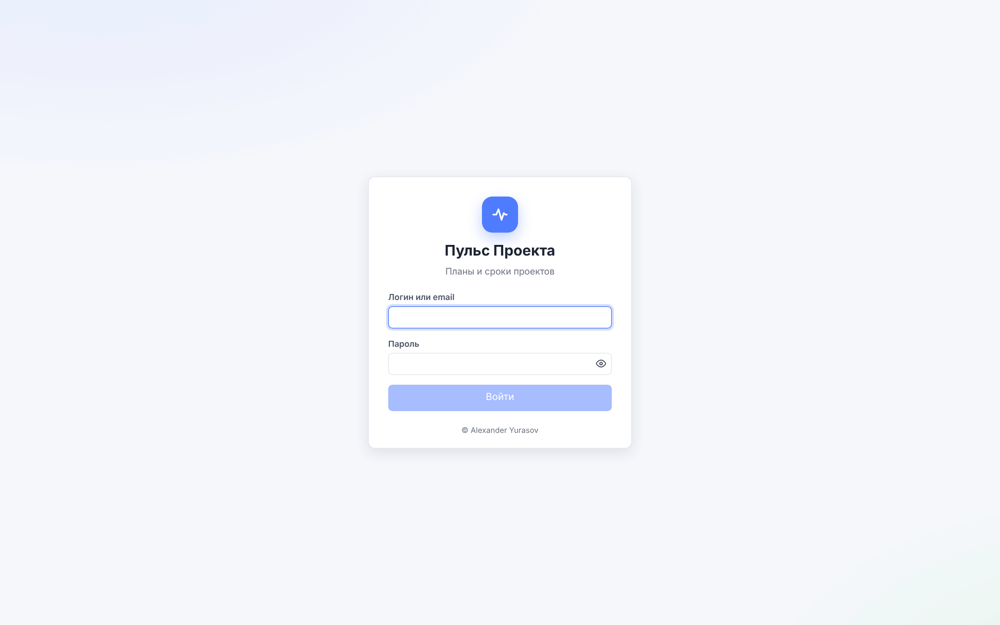

> **Важно.** После перехода на версию 0.2 войдите заново — логин и пароль прежние. Старые ссылки на проекты
> вида `…/#/project/5` продолжают работать.

Сессия действует 30 дней. Если администратор отключит учётную запись или сменит пароль, вход завершится на
всех устройствах.

## Интерфейс

- **Боковое меню** слева: «Проекты», список направлений с их проектами (раскрываются щелчком), разделы
  администрирования (только администратору), ваш профиль, «Выйти», знак «?» — «О программе», номер версии.
  Кнопка **‹** сворачивает меню.
- **Рабочая область** справа: главная страница с проектами или экран проекта.
- **Уведомления** появляются в правом нижнем углу: «Сохранено», «Строка удалена — Отменить», ошибки.
- Все вопросы и подтверждения — окна системы с понятными кнопками. Esc закрывает окно.

## Профиль, пароль и фото

Щёлкните своё имя внизу бокового меню. В окне «Профиль» можно загрузить или удалить фото (оно видно коллегам
в списках и в «Сейчас на плане») и сменить пароль. Пароль — не короче 8 символов; после смены остальные
сеансы завершатся. Сотрудники, входящие через домен, меняют пароль средствами домена.

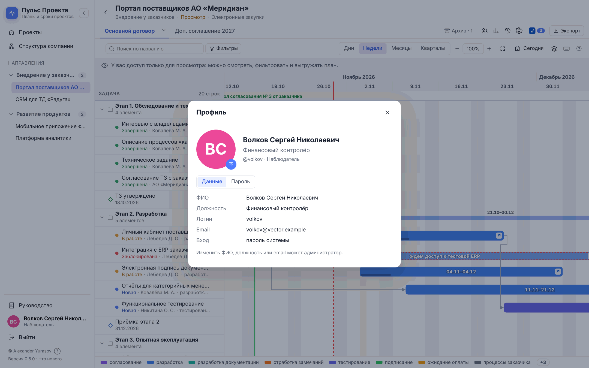

# Проекты

## Главная страница

Главная страница показывает проекты, к которым у вас есть доступ, по направлениям. На карточке проекта:

- название и описание;
- **прогресс** — доля завершённых задач;
- число задач, из них **в работе**, **просрочено** (окончание прошло, задача не завершена) и **заблокировано**;
- **ближайшая веха** — дата и название;
- ваш уровень доступа, число планов, дата последнего изменения.

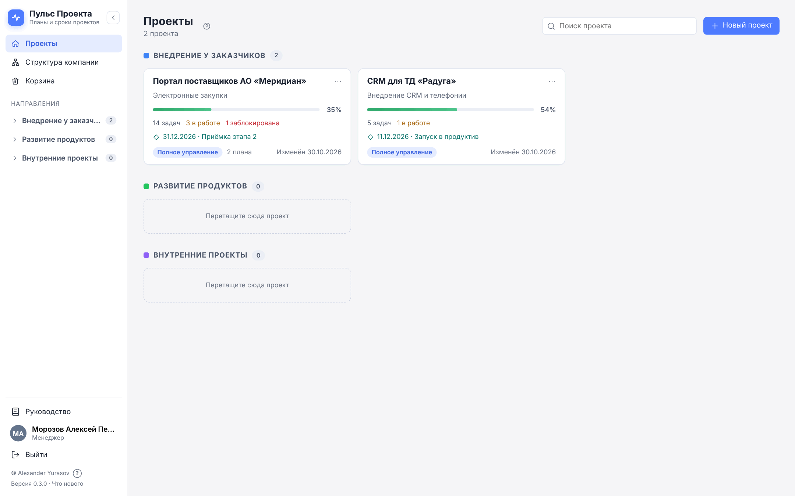

**Поиск проекта** — поле вверху справа. Щелчок по карточке открывает проект.

## Новый проект

Создавать проекты могут менеджеры и администраторы. Нажмите **Новый проект** (или **+** у заголовка
направления), укажите название, при необходимости описание и направление, нажмите **Создать**. Проект
откроется с пустым планом. Создатель-менеджер получает полное управление проектом.

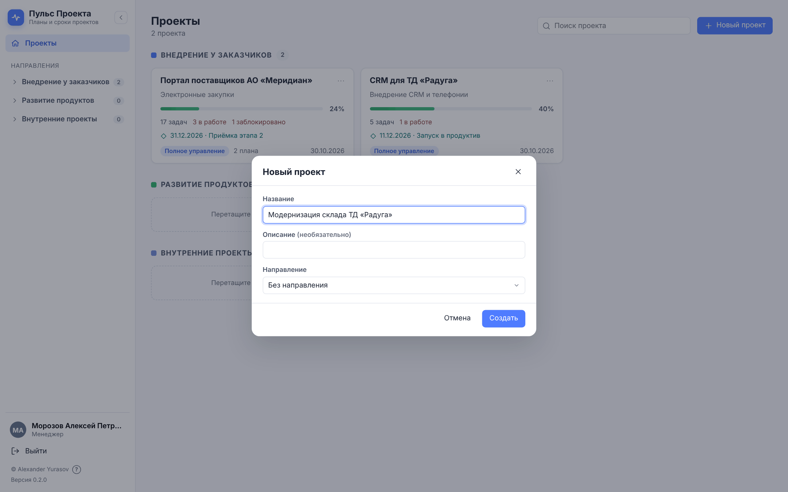

## Изменение, порядок и удаление

- **⋯** на карточке (при полном управлении) → **Изменить**: название, описание, направление.
- Карточку можно перетащить в другое направление или поменять порядок внутри направления.
- **Удалить** проект может администратор; проект попадает в корзину и восстанавливается оттуда.

# План проекта

## Экран плана

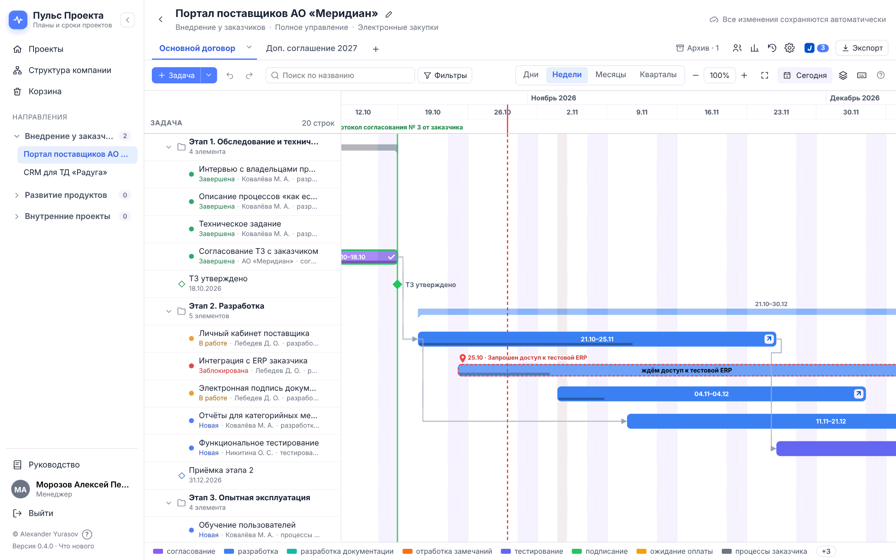

Сверху вниз:

1. **Заголовок проекта**: название (карандаш — переименовать), направление, ваш уровень доступа, описание.
   Справа — «Сейчас на плане» (кто ещё открыл план) и состояние сохранения.
2. **Вкладки планов** и справа — **Архив**, действия с планом: **Исполнители**, **Статистика**, **История и
   сохранённые версии**, **Настройки графика**, **Экспорт**.
3. **Панель инструментов**: **Задача** (и ▾ — добавить веху, группу, пометку), **Отменить** / **Повторить**,
   поиск, **Фильтры**; шкала **Дни / Недели / Месяцы / Кварталы**, масштаб, **Весь период**, **Сегодня**,
   **Вид**.
4. **Таблица** слева: строки с названием, статусом, ответственным и категорией; группы сворачиваются стрелкой.
   Внизу — поле «Новая задача — введите название и Enter».
5. **Шкала** справа: полосы задач и групп, ромбы вех, линии вех и линия «сегодня», пометки, стрелки связей,
   выходные и праздники.
6. **Легенда** внизу (если включена в настройках графика).

Ширину таблицы можно поменять, перетащив границу между таблицей и шкалой.

## Планы проекта

У проекта может быть несколько планов — например, «Основной договор» и «Доп. соглашение 2027». Каждый план —
вкладка над диаграммой.

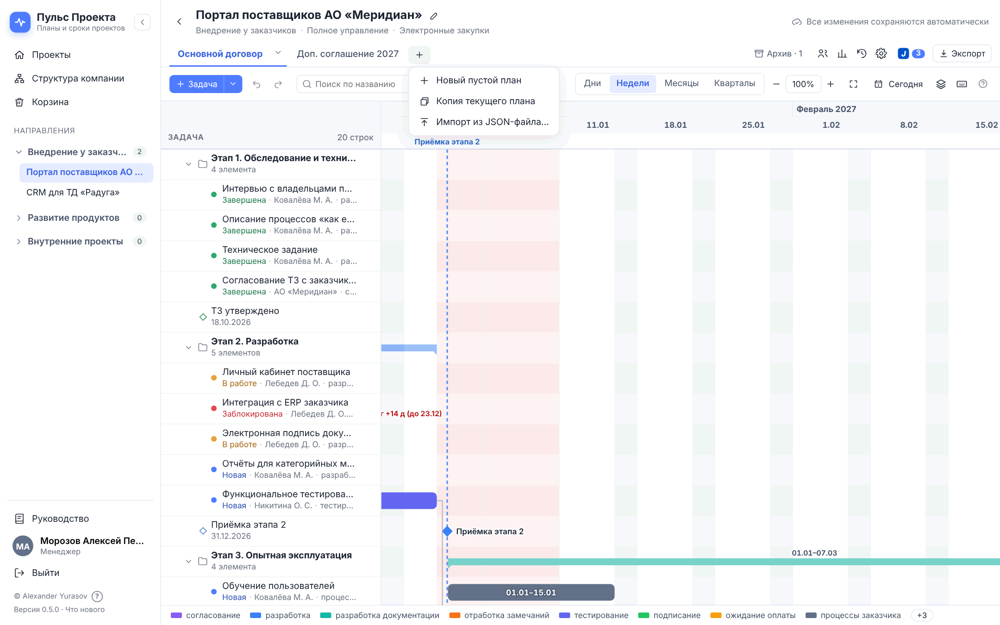

- **+** справа от вкладок: **Новый пустой план**, **Копия текущего плана**, **Импорт из JSON-файла…** (в том
  числе файла, выгруженного из версии 1.0).
- **▾** на активной вкладке или щелчок правой кнопкой по вкладке: **Переименовать** (или двойной щелчок),
  **Дублировать**, **Экспорт JSON**, **Убрать в архив**.
- Вкладки можно перетаскивать, меняя порядок.
- **Архив · N** справа — архивные планы: открыть для просмотра или **Вернуть во вкладки**. Архивный план
  открывается только для просмотра.

> **Совет.** Чтобы показать заказчику вариант графика, не трогая основной, сделайте **Копию текущего плана** и
> правьте копию. Ненужный вариант уберите в архив — он не потеряется.

Удалить архивный план (в корзину) может сотрудник с полным управлением проектом; удалить навсегда — только
администратор.

## Шкала и масштаб

- **Дни / Недели / Месяцы / Кварталы** — подписи и сетка шкалы.
- **− 100 % +** — масштаб; удобнее: Ctrl + колесо мыши над шкалой.
- **Весь период** (значок рамки) — весь план на ширину экрана.
- **Сегодня** — прокрутить к текущей дате.

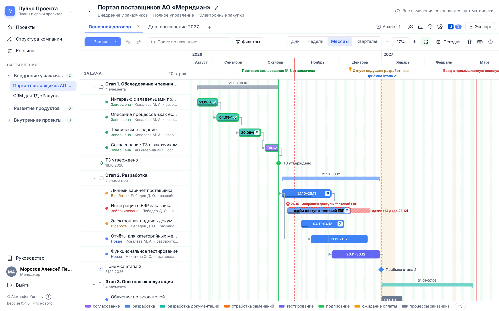

Выходные выделены серым, праздники — розовым по производственному календарю РФ (с переносами и рабочими
субботами). Красная пунктирная линия — сегодня.

## Сохранение и совместная работа

Отдельной кнопки «Сохранить» нет: каждое изменение применяется на экране сразу и отправляется на сервер.
Справа в заголовке:

- «Все изменения сохраняются автоматически» или «Сохранено только что» — всё отправлено;
- «Сохранение…» — изменения отправляются;
- «Нет связи · 2 изменения ждут отправки» — связь пропала; правки хранятся на странице и уйдут, когда связь
  вернётся. Не закрывайте вкладку: при попытке закрыть система предупредит о неотправленных правках.

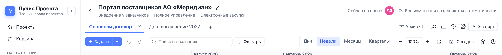

**Изменения коллег** появляются через несколько секунд и ненадолго подсвечиваются. «Сейчас на плане» —
кто ещё смотрит план (подсказка при наведении), обводка — кто правит.

**Одновременная правка.** Двое могут править один план: сервер применяет изменения по отдельным полям, и
правка одного не стирает другую. Если вы поменяли то же поле той же строки, что коллега минутой раньше,
система сообщит «Одновременная правка: … только что менял(а) строку …» — ваше значение сохранено, прежнее
видно в истории строки.

# Строки плана

## Добавление строк

- **Задача** на панели — новая задача после выделенной строки (в выделенную группу — внутрь группы).
  Клавиша Insert делает то же.
- **▾** рядом с **Задача**: **Задача**, **Веха**, **Группа**, **Пометка на шкале**.
- Поле внизу таблицы «Новая задача — введите название и Enter» — быстрое добавление подряд.
- Щелчок правой кнопкой по шкале — **Добавить на <дату>**: задачу, веху, группу или пометку на эту дату.

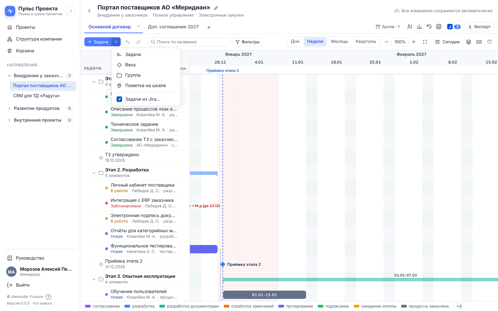

Новая строка сразу открывается в карточке.

## Карточка строки

Щелчок по значку карточки у строки, Enter на выделенной строке или **Открыть карточку** в меню открывают
карточку справа. Изменения в карточке применяются сразу.

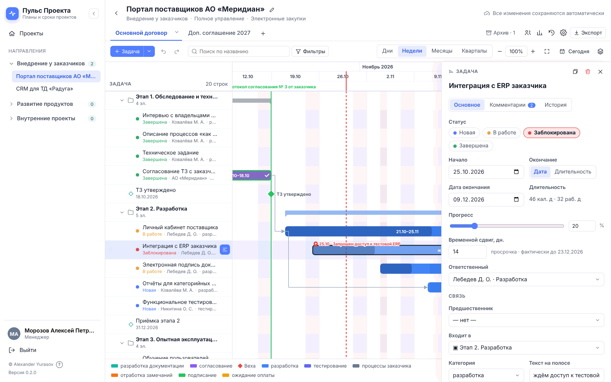

Поля задачи:

| Поле | Что задаёт |
| ----------------- | ----------------------------------------------------------- |
| Название | Текст строки; Enter — готово |
| Статус | Новая, В работе, Заблокирована, Завершена. При завершении система спросит дату завершения |
| Начало, Окончание | Даты задачи. Окончание задаётся **датой** или **длительностью** — в календарных или рабочих днях (по производственному календарю); под полем видно и то и другое |
| Прогресс | 0–100 %, тёмная часть полосы |
| Временной сдвиг, дн. | «+» — просрочка, «−» — ранняя сдача; фактическое окончание показывается штриховкой после полосы и подписью «сдвиг +14 д» |
| Ответственный | Исполнитель плана (см. «Исполнители плана») |
| Предшественник, Тип связи, Лаг | Связь с другой задачей или вехой (см. «Связи и автосдвиг») |
| Входит в | Группа или задача-родитель |
| Категория | Из справочника категорий плана; задаёт подпись в легенде |
| Текст на полосе | Вместо дат на полосе — свой текст |
| Задача в Jira | Ссылка `http(s)://…`; кнопка рядом открывает задачу |
| Цвет | Цвет полосы |

Подсказки под датами показывают ограничения: «В пределах родительской задачи…», «По связи начало не раньше…».

Вкладки карточки: **Основное**, **Комментарии**, **История**. Вверху — **Дублировать** (Ctrl+D), **Удалить**
(Delete), **Закрыть** (Esc).

## Завершение задачи

При выборе статуса **Завершена** система предлагает дату завершения: **В плановый срок** (дата окончания),
**Сегодня** или любую другую. Если задача завершена позже или раньше плана, сдвиг рассчитывается от планового
окончания автоматически.

## Вехи

Веха — ключевая дата: ромб в своей строке и вертикальная линия через весь график с подписью над шкалой.

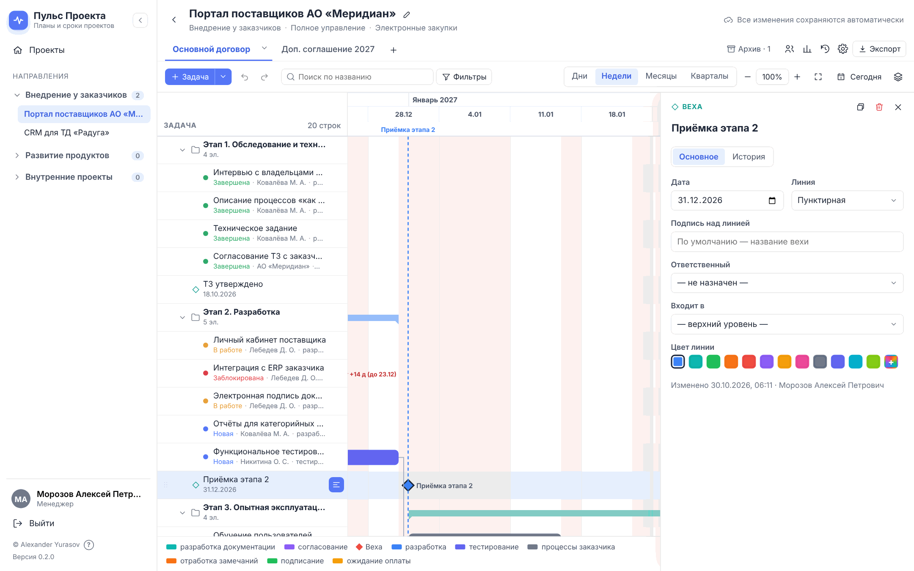

В карточке вехи: дата, **Линия** (сплошная, пунктир, точки), цвет линии, **Подпись над линией** (по умолчанию —
название вехи), ответственный, группа. Подписи вех над шкалой раскладываются по ярусам и не накладываются.

## Группы

Группа объединяет строки; её полоса показывает период от самого раннего начала до самого позднего окончания
вложенных задач и вех. Свернуть или развернуть группу — стрелка слева от названия; **Вид → Свернуть все
группы / Развернуть все группы**. Группы можно вкладывать друг в друга.

## Связи и автосдвиг

Связь «предшественник» задаёт, от чего зависит задача:

| Тип | Правило |
| -------------------- | ---------------------------------------------------- |
| FS — окончание → начало | Задача начинается на следующий день после окончания предшественника |
| SS — начало → начало | Задача начинается вместе с предшественником |
| FF — окончание → окончание | Задача заканчивается вместе с предшественником, длительность сохраняется |
| SF — начало → окончание | Задача заканчивается в день начала предшественника |

**Лаг** — задержка (+) или опережение (−) в днях. Для предшественника берётся окончание с учётом временного
сдвига, у завершённого — фактическая дата завершения.

Когда включён **Автосдвиг задач по связям** (настройки графика, по умолчанию включён), перенос задачи
сдвигает все зависящие от неё задачи по цепочке. Если сроки каких-то задач не соответствуют связям
(например, план перенесён из 1.0), над графиком появится строка «Сроки N задач не согласованы со связями» и
кнопка **Выровнять по связям**; выравнивание отменяется Ctrl+Z.

Стрелки связей на шкале можно скрыть в настройках графика.

## Перетаскивание

- Полоса задачи — сдвинуть сроки; край полосы — изменить начало или окончание.
- С нажатым Ctrl — копия задачи на новые даты.
- Полоса группы — сдвинуть всю группу с вложенными.
- Ромб вехи — перенести веху.
- Строку в таблице — за значок ⋮⋮ слева: между строками — порядок, на группу или задачу — внутрь.

Во время перетаскивания подсказка показывает новые даты. Отмена — Ctrl+Z.

## Контекстное меню

Щелчок правой кнопкой по строке (в таблице или на шкале):

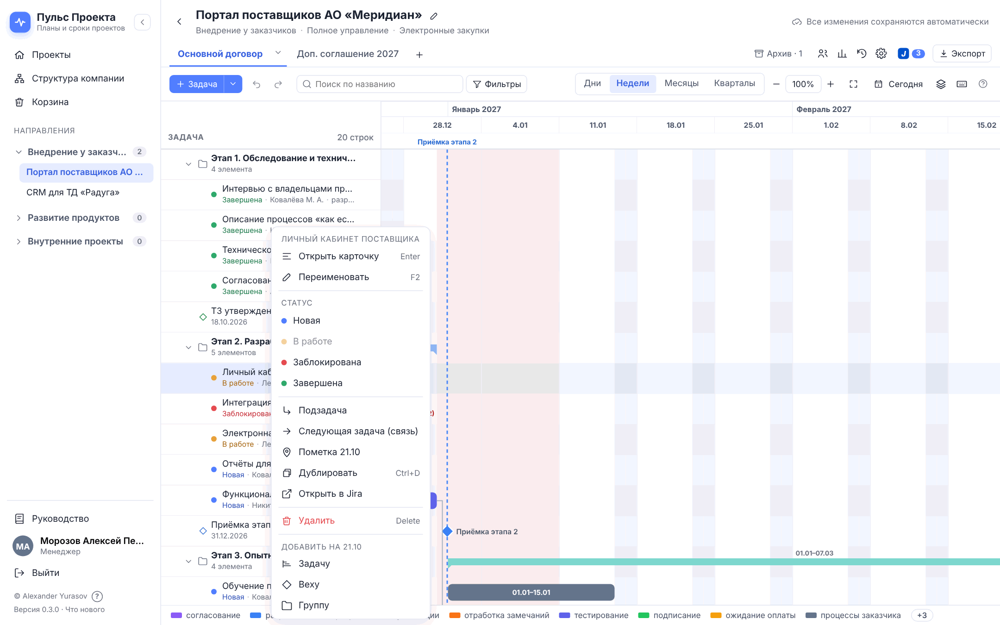

**Открыть карточку**, **Переименовать** (F2), **Статус**, **Подзадача**, **Следующая задача (связь)** —
новая задача, которая начнётся после этой, **Пометка** на дату под курсором, **Дублировать**, **Открыть в
Jira**, **Удалить**; для группы — **Задача в группу** и **Подгруппа**; внизу — **Добавить на <дату>**.

## Пометки

Пометка — флажок с текстом на дате: «Запрошен доступ…», «Отпуск ведущего разработчика». Привязка — к строке
(флажок в её ряду) или ко всему графику (над шкалой). Добавить — меню **Задача ▾ → Пометка на шкале** или
**Пометка** в контекстном меню; изменить или удалить — щелчок по флажку. Пометки можно скрыть в настройках
графика.

## Комментарии

Вкладка **Комментарии** в карточке задачи: обсуждение строки с ответами. Свой комментарий можно изменить или
удалить. Число комментариев видно на вкладке.

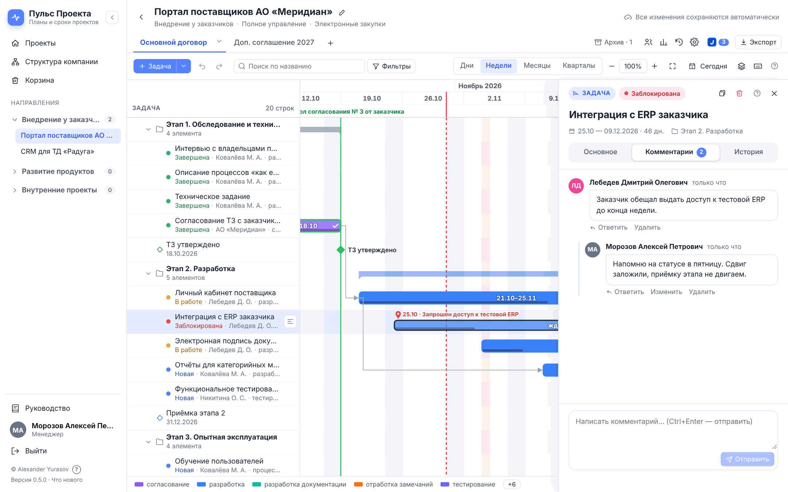

## История строки

Вкладка **История** — все изменения строки: кто, когда, какое поле и как изменилось («Прогресс: 55 % → 60 %»).
Записи, перенесённые из версии 1.0, помечены «из 1.0».

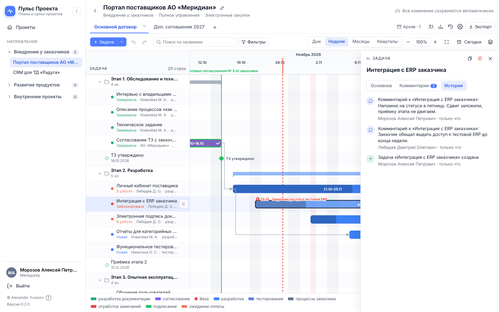

## Удаление и отмена

- Одна строка без вложенных удаляется сразу (Delete, **Удалить** в карточке или меню), в уведомлении —
  **Отменить**.
- Если внутри строки есть вложенные, система спросит: **Оставить вложенные** (поднять их на уровень выше) или
  **Удалить всё**.
- **Отменить** / **Повторить** на панели (Ctrl+Z / Ctrl+Shift+Z) отменяют ваши последние правки по одной.
- Любое прежнее состояние плана — в «Истории плана» (см. ниже).

## Клавиши

| Клавиша | Действие |
| ------------------ | ------------------------------------------------------ |
| Insert | Новая задача после выделенной строки |
| Enter | Открыть карточку выделенной строки |
| F2 | Переименовать строку |
| Delete | Удалить строку |
| Ctrl+D | Дублировать строку |
| ↑ / ↓ | Предыдущая / следующая строка |
| Esc | Закрыть карточку, снять выделение, закрыть окно |
| Ctrl+Z, Ctrl+Shift+Z (Ctrl+Y) | Отменить, повторить |
| Ctrl + колесо | Масштаб шкалы |

# Поиск, фильтры и вид

## Поиск и фильтры

**Поиск по названию** оставляет строки, в названии которых есть введённый текст (и группы, в которых они
лежат).

**Фильтры** — по статусу, исполнителю и категории; рядом с каждым значением — сколько задач под него
подходит. Внутри одного фильтра действует «любое из отмеченного», между фильтрами — «все условия». Включённые
фильтры видны строкой под панелью: × убирает значение, **Сбросить** — все.

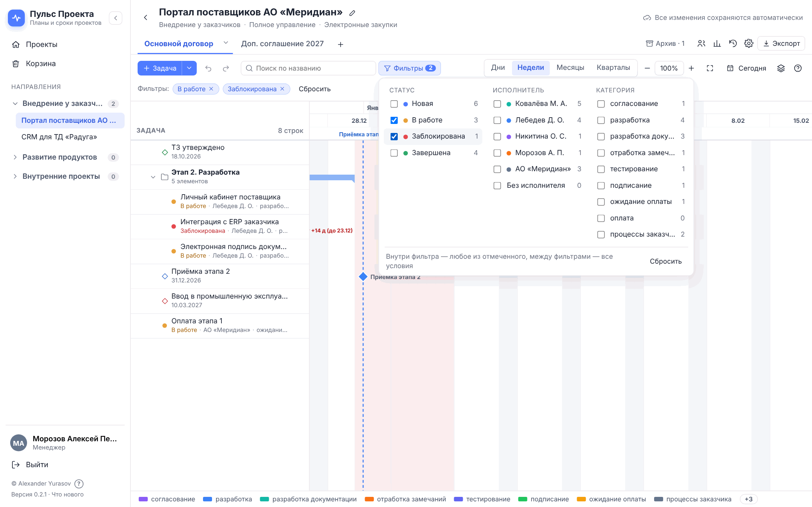

Фильтры и поиск — только у вас и не меняют план.

## Колонки и группы

**Вид** (значок слоёв справа на панели): колонки таблицы — **Начало**, **Окончание**, **Длительность**,
**Ответственный**, **Прогресс**; **Развернуть все группы**, **Свернуть все группы**.

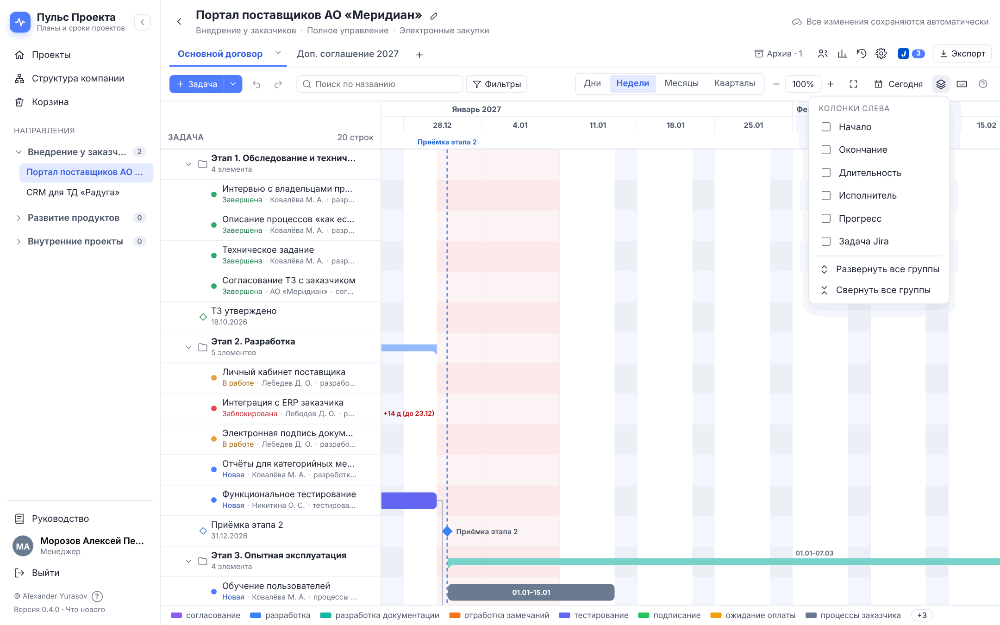

## Свой вид и вид по умолчанию

Шкала, масштаб, ширина таблицы, свёрнутые группы и колонки — у каждого сотрудника свои: они запоминаются в
вашем браузере и не мешают коллегам. Чтобы коллеги открывали план так же, как вы, — **Настройки графика →
Сделать мой вид видом по умолчанию**.

# Настройки графика

**Настройки графика** (шестерёнка в строке вкладок) — общие для всех, кто открывает план. Менять их может
сотрудник с правом редактирования.

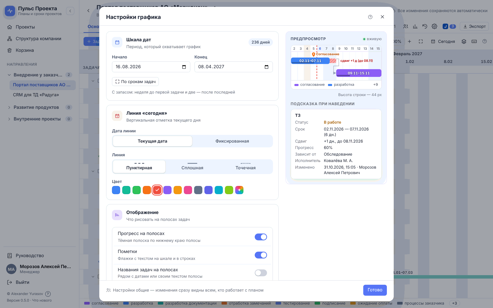

| Раздел | Что настраивается |
| ------------- | ------------------------------------------------------------- |
| Шкала дат | Начало и конец шкалы; **По срокам задач** — подогнать под план |
| Линия «сегодня» | Текущая дата или фиксированная (например, дата отчёта); стиль и цвет линии |
| Отображение | Прогресс на полосах, пометки, названия задач на полосах, подписи временных сдвигов, стрелки связей, высота строки |
| Календарь и связи | Производственный календарь РФ, выделение выходных и праздников, автосдвиг задач по связям |
| Легенда | Показывать, где (снизу или сверху), состав (все строки или только верхнего уровня) |
| Подсказка у полосы | Что показывать при наведении: статус, сроки и сдвиг, прогресс, предшественник, ответственный, последнее изменение |
| Категории задач | Справочник категорий плана: добавить, удалить |
| Вид по умолчанию | Сделать ваш вид видом по умолчанию для коллег |

# Исполнители плана

**Исполнители** (значок людей в строке вкладок) — список ответственных этого плана: ФИО, роль в проекте, цвет.
Исполнителя можно связать с сотрудником системы — тогда видно его фото. Внешних участников (заказчик,
подрядчик) добавляйте без связи.

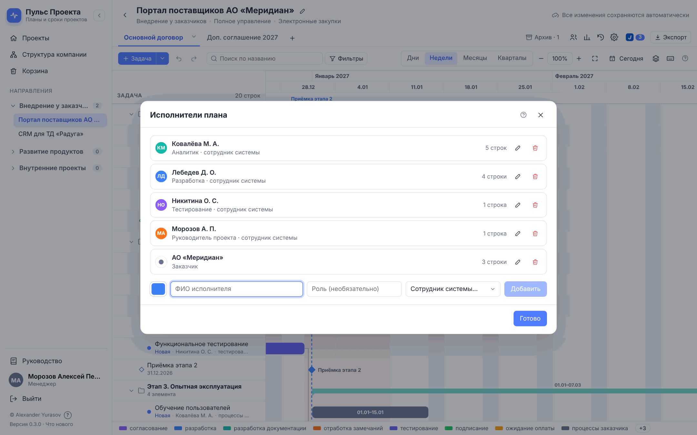

Рядом с исполнителем — сколько строк ему назначено. Удалённый исполнитель снимается со строк (это видно в
истории).

# Статистика

**Статистика** (значок диаграммы) — сводка по плану: число задач, средний прогресс, просроченные сейчас,
группы и вехи, средняя длительность; распределение по статусам; сдвиги сроков (сколько задач сдвинуто,
средняя и максимальная просрочка, больше всего сдвинутые); просроченные на сегодня; ближайшие вехи; задачи по
исполнителям и группам.

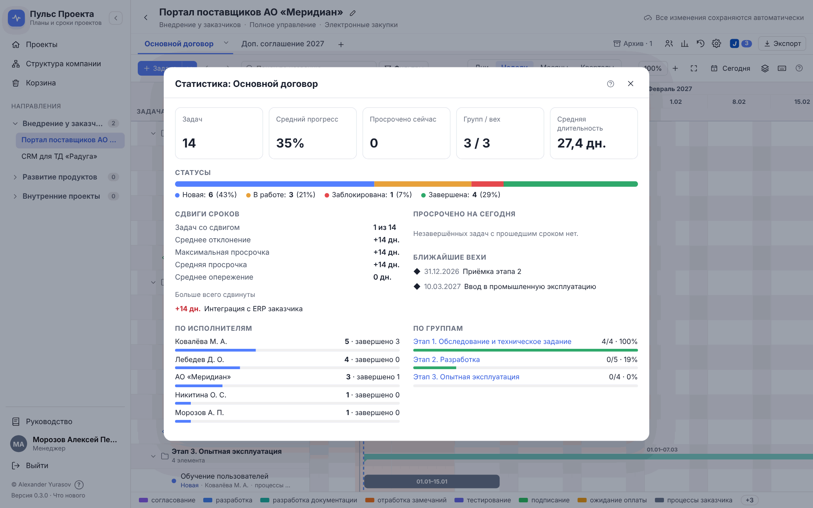

# История плана и версии

**История и сохранённые версии** (значок часов со стрелкой) — две вкладки.

**Журнал изменений** — все изменения плана по дням: что сделано, кто, когда. Фильтр — по сотруднику.

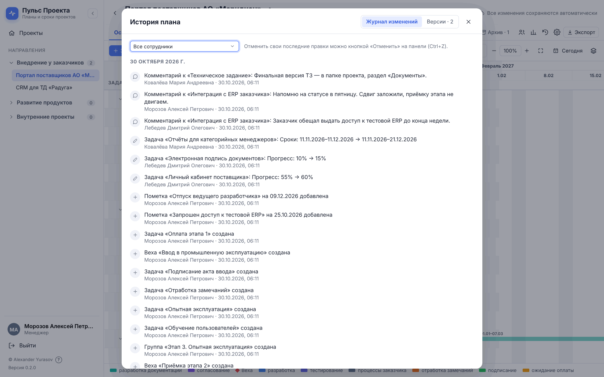

**Версии** — сохранённые состояния плана:

- автоматические — система сохраняет состояние перед правками не чаще раза в 30 минут; хранятся все за двое
  суток, затем по одной в день за 60 дней и по одной в неделю;
- ручные — **Сохранить текущую версию** с названием («Согласованный график», «Перед переносом сроков»);
- «Перенос из 1.0.1» — состояние плана сразу после перехода на 0.2.

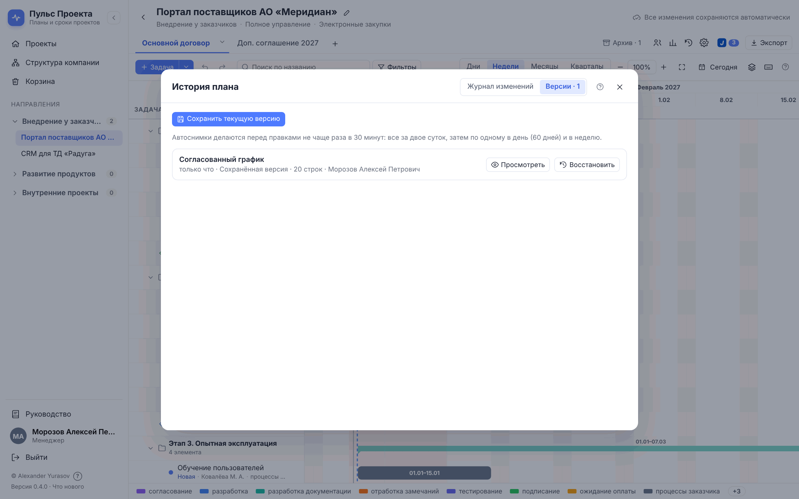

**Просмотреть** — план в выбранном состоянии (только просмотр, над графиком — **Вернуться к текущему**).
**Восстановить** — вернуть план к этому состоянию; текущее состояние перед этим сохраняется как версия «Перед
восстановлением», так что восстановление тоже можно отменить.

# Экспорт

**Экспорт** в строке вкладок:

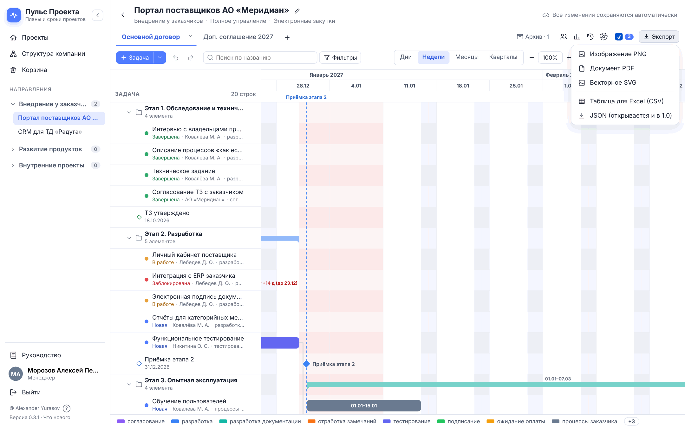

| Формат | Для чего |
| ---------------------- | -------------------------------------------------- |
| Изображение PNG | Вставить в письмо или презентацию |
| Документ PDF | Отправить или распечатать |
| Векторное SVG | Без потери качества при увеличении |
| Таблица для Excel (CSV) | Строки плана с датами, статусами, ответственными |
| JSON (открывается и в 1.0) | Перенести план в другой проект (импорт) или открыть в версии 1.0 |

Выгружается то, что видно: с учётом фильтров, свёрнутых групп, шкалы и легенды.

# Только просмотр

Если у вас доступ «Просмотр» (или роль «Наблюдатель»), план открывается без инструментов правки, а над
графиком — пояснение. Можно смотреть, искать, фильтровать, менять шкалу и масштаб, открывать карточки,
историю, версии и статистику, выгружать.

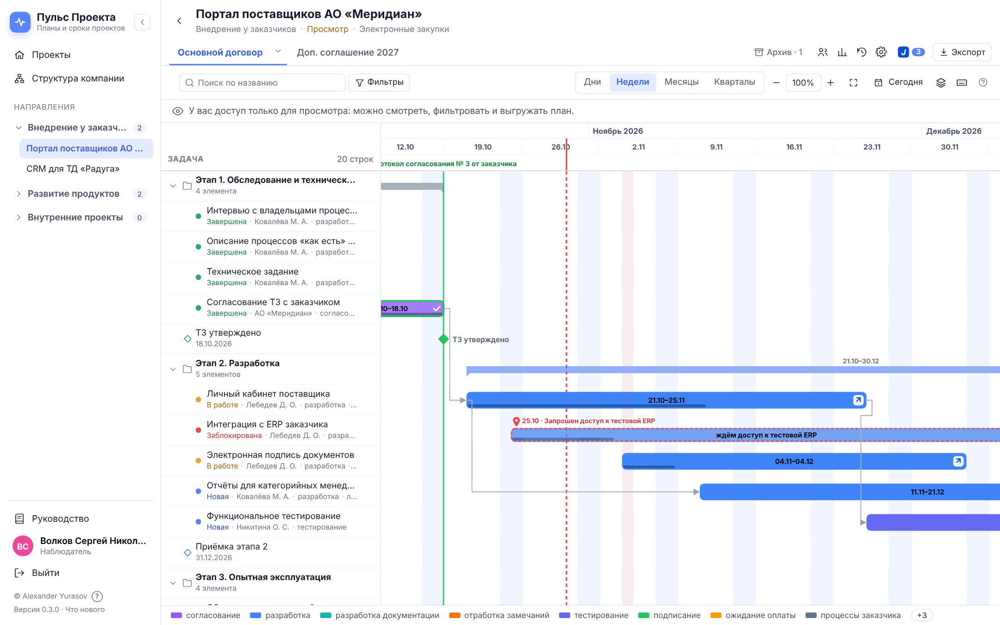

# Пользовательские сценарии

## Сценарий 1. План нового проекта

1. **Новый проект** → название, направление → **Создать**.
2. **Исполнители** → добавьте участников (сотрудников и заказчика).
3. **Задача ▾ → Группа** — этапы проекта; внутри — задачи (Insert или поле внизу таблицы).
4. В карточке задачи — сроки, ответственный, категория; для следующей задачи — контекстное меню **Следующая
   задача (связь)**.
5. **Задача ▾ → Веха** — ключевые даты (подписание ТЗ, приёмка, ввод в эксплуатацию).
6. **Настройки графика → Шкала дат → По срокам задач**; включите легенду.
7. **История → Версии → Сохранить текущую версию** «Согласованный график».

## Сценарий 2. Еженедельный статус

1. Откройте план, **Фильтры → Статус: В работе, Заблокирована**.
2. Обновите прогресс и статусы в карточках; блокировку опишите в комментарии.
3. Сорвавшийся срок отметьте **временным сдвигом** — на графике появится штриховка и подпись «сдвиг +N д».
4. **Статистика** — что просрочено и где сдвиги больше всего.
5. **Экспорт → PDF** — в письмо руководителю.

## Сценарий 3. Перенос срока с зависимыми задачами

1. Перетащите полосу задачи на новые даты (или измените дату в карточке).
2. Зависимые задачи сдвинутся по связям автоматически.
3. Не тот результат — Ctrl+Z отменяет перенос вместе со сдвигом зависимых.

## Сценарий 4. Вариант графика для заказчика

1. **+** у вкладок → **Копия текущего плана**, переименуйте («Вариант со сдвигом этапа 3»).
2. Правьте копию — основной план не меняется.
3. **Экспорт → PDF** для заказчика; после согласования уберите ненужный вариант в архив.

## Сценарий 5. Ошибочная правка

1. Только что — Ctrl+Z или **Отменить** в уведомлении.
2. Давно или не вашу — **История → Журнал изменений**: найдите, кто и что поменял.
3. **История → Версии** → **Просмотреть** состояние до ошибки → **Восстановить**.

# Частые вопросы

**Где кнопка «Сохранить»?** Её нет: всё сохраняется сразу. Состояние сохранения — справа в заголовке проекта.

**Коллега говорит, что поменял срок, а у меня старый.** Изменения коллег приходят в течение нескольких секунд.
Если строка «Нет связи» — дождитесь восстановления связи.

**Я закрыл вкладку плана — данные пропали?** Нет: план в архиве (**Архив** справа от вкладок).

**Почему я не могу ничего менять?** У вас доступ «Просмотр» или роль «Наблюдатель» — см. пояснение над графиком.
Обратитесь к руководителю проекта или администратору.

**Почему даты задачи сдвинулись сами?** Задача связана с предшественником, и включён автосдвиг: перенос
предшественника двигает зависимые задачи. Связь — в карточке, раздел «Связь».

**Почему у задачи «сдвиг +14 д»?** В карточке задан временной сдвиг: фактическое окончание позже планового.
Уберите сдвиг — поставьте 0.

**Как отдать план в старую версию 1.0?** **Экспорт → JSON (открывается и в 1.0)**.
